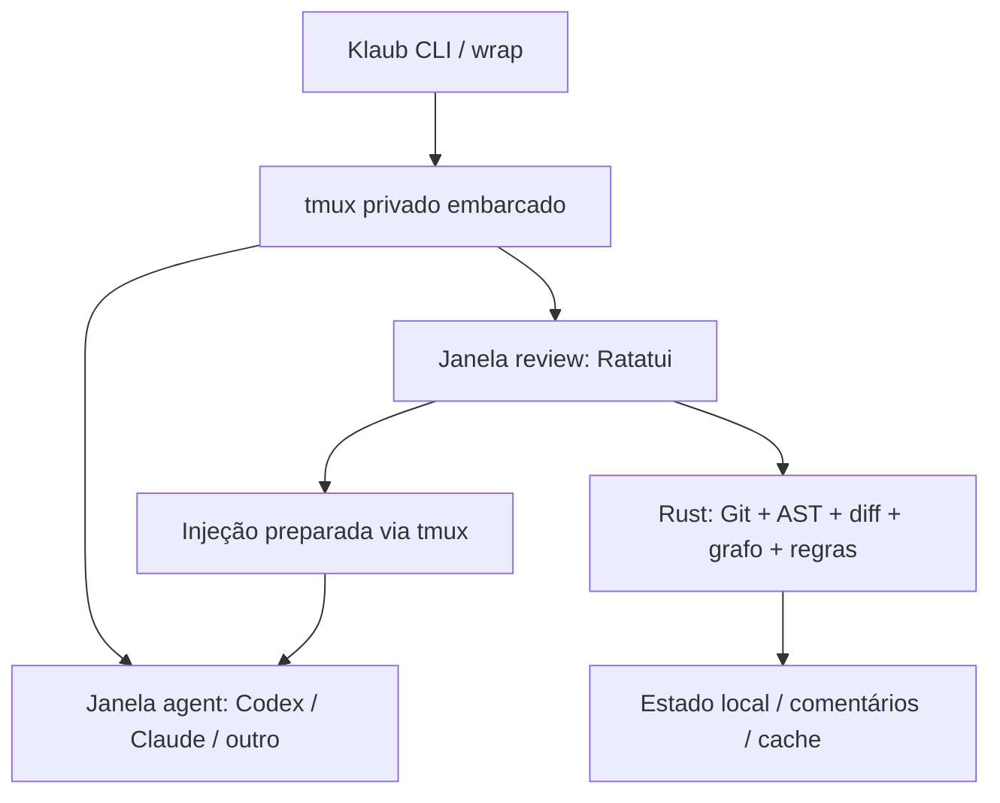

# Klaub. Especificação de Produto e Arquitetura

**Versão:** 1.2, fluxo de alterações integrado  
**Data:** 31/10/2026  
**Status:** especificação de referência, não implementação concluída  
**Plataformas iniciais:** Linux e macOS  
**Tecnologia principal:** Rust, tmux empacotado e Ratatui  
**Experiência:** CLI que envolve qualquer harness de programação e oferece revisão semântica fullscreen na mesma sessão de terminal.

> **Princípio central:** o desenvolvedor lê o código real, identifica rapidamente o que merece revisão e devolve instruções precisas ao agent, sem sair do terminal nem perder a sessão em execução. **Klaub é um revisor de código para humanos**, não um agente revisor, certificador de qualidade ou executor autônomo.

---

## 1. Resumo executivo

Klaub é um **wrapper de agentes de programação** e um **revisor semântico de alterações Git**. O usuário inicia seu harness habitual com `klaub wrap codex`, `klaub wrap claude` ou outro comando. O Klaub cria uma sessão própria de tmux, executa o harness em uma janela e reserva outra janela para um revisor de código escrito em Rust com Ratatui.

O revisor não parte de linhas adicionadas/removidas. Ele organiza o trabalho em **módulos, arquivos, classes, funções, métodos e blocos**, identifica alterações de contrato e comportamento, correlaciona chamadas e entrypoints potencialmente afetados e coloca as mudanças em uma fila de revisão priorizada.

Ao concluir, o usuário salva o feedback e pode escolher **Preparar no agent**, ação confirmada separadamente que cola uma instrução curta e a referência ao arquivo de comentários no pane original. Por padrão, **não cola sem confirmação nem pressiona Enter**. O usuário revisa a instrução e escolhe quando submetê-la. O agent continua na mesma sessão, sem reinicialização nem integração obrigatória com seu protocolo interno.

O núcleo de revisão funciona **offline, sem LLM e sem conta externa**. Não existe chat embutido nem configuração de API OpenAI-compatible.

O produto deve ajudar o humano a responder: **o que mudou, por que mudou, o que pode ser afetado, quais evidências existem e o que ainda preciso inspecionar?** Intenção da tarefa, associação de testes, problemas introduzidos, inspeção de contratos, validação de comentários e cobertura de revisão são ferramentas de apoio. Nenhuma delas aprova, reprova ou corrige código automaticamente.

Na fase 2, uma **skill complementar `klaub-flow`** pode usar o próprio Codex/Claude Code para descrever, em um arquivo estruturado, o fluxo de execução relacionado ao snapshot em revisão. O Klaub apenas verifica, valida e apresenta o arquivo; não executa LLM nem confia no diagrama como substituto do código.

### Resultado esperado

- Uma revisão mais rápida, especialmente de arquivos novos, reescritas extensas e alterações geradas por agents.
- Maior clareza sobre **o código efetivo** e sobre o **alcance das alterações**, sem resumos substituindo a leitura humana.
- Integração universal com harnesses que oferecem uma TUI ou CLI interativa.
- Distribuição simplificada: **um executável Klaub por plataforma/arquitetura**, com o tmux embarcado e extraído de forma gerenciada.

## 2. Problema e diferenciação

### Limitações do diff convencional

1. O alinhamento de linhas perde utilidade quando um arquivo é novo, foi movido ou quase totalmente reescrito.
2. A apresentação lado a lado fragmenta a leitura, desperdiça largura e exige comparar visualmente duas versões.
3. Um diff textual não responde, por si só, **qual contrato mudou, quem chama esse código e que entrypoint pode ser afetado**.
4. Uma lista de centenas de arquivos impõe uma sequência arbitrária ou alfabética, e não o risco relevante.
5. Comentários de revisão ficam separados do ciclo interativo do agent ou exigem copiar e colar manualmente.

### Diferenciais de produto

| Capacidade | Experiência Klaub |
| --- | --- |
| Diff estrutural | Navegar por módulo, classe, função, método e bloco |
| Leitura fullscreen | Uma versão do código por vez, usando toda a largura |
| Comparação temporal | Alternar entre `antes` e `depois` no mesmo viewport |
| Reescritas e arquivos novos | Ver código integral e unidades semânticas, sem depender de hunks |
| Priorização auditável | P0–P3 com evidências, regras e confiança separadas |
| Impacto arquitetural | Mudanças locais, entre módulos e globais, por profundidade estrutural |
| Fluxos de execução | Grafo reverso de chamadas até entrypoints internos/externos |
| Agent no mesmo fluxo | Troca instantânea entre harness e review pelo tmux |
| Feedback universal | Comentários persistidos e preparados no input original |
| Sem IA obrigatória | Análise determinística, local e offline |
| Intenção explícita | Brief e critérios de aceite escritos pelo humano, vinculados à revisão |
| Evidências de testes | Testes relacionados, execução opcional e lacunas observáveis, sem declarar cobertura inexistente |
| Risco incremental | Distinguir achados introduzidos, preexistentes, removidos e incertos |
| Inspeção de contratos | Comparar APIs, assinaturas e efeitos observáveis com evidências |
| Retorno de revisão | Conferir cada comentário frente à rodada seguinte, sem resolução automática |
| Cobertura humana | Mostrar o que foi efetivamente inspecionado e o que ainda falta |
| Fluxo explicativo da alteração | Skill opcional gera diagrama versionado e navegável, com referências aos símbolos reais |
| Diagrama ausente | Klaub avisa e prepara uma solicitação no input do harness, para envio humano com Enter |

## 3. Objetivos, não objetivos e premissas

### Objetivos de P0 de produto

1. Iniciar um harness existente e preservar seu estado ao alternar janelas.
2. Mostrar o **código real** da worktree, prioritariamente a versão atual, com acesso imediato à anterior.
3. Navegar alterações por unidades semânticas em arquivos modificados, novos e removidos.
4. Exibir uma fila de revisão com prioridade e motivos verificáveis.
5. Mostrar caminhos de dependência/chamada dos símbolos alterados até possíveis entrypoints.
6. Registrar comentários em posições semânticas, persistindo-os no repositório.
7. Encerrar a revisão e entregar um prompt preparado ao harness por tmux, com confirmação humana como padrão.
8. Funcionar sem acesso à rede e sem credenciais de LLM.
9. Permitir que o revisor registre a intenção da mudança e critérios de aceite, sem tentar extrair ou adivinhar o objetivo a partir do histórico privado do harness.
10. Relacionar alterações a testes e separar problemas novos dos preexistentes, sempre indicando a origem e a confiança da evidência.
11. Mostrar pendências e progresso da **inspeção humana**, sem emitir aprovação automática.
12. Reconhecer um diagrama de fluxo correspondente à alteração atual e navegar suas etapas até o código; quando ele faltar ou estiver obsoleto, oferecer geração pelo harness sem executar LLM no Klaub.

### Não objetivos do MVP

- Construir um emulador de terminal ou substituir o Ghostty, Tabby, WezTerm etc.
- Construir um multiplexador próprio em substituição ao tmux.
- Integrar chat, API OpenAI-compatible, modelos locais ou armazenamento de API keys.
- Gerar resumos de código por IA ou executar correções automaticamente no motor de revisão.
- Prometer análise perfeita de chamadas dinâmicas, despacho indireto ou reflexão.
- Fornecer uma aplicação Tauri, plugin Tabby, extensão VS Code ou UI no navegador no primeiro release.
- Publicar comentários, código ou telemetria em serviços externos por padrão.
- Editar o código-fonte diretamente no revisor no MVP.
- Validar de ponta a ponta a tarefa do agente, certificar ausência de defeitos ou substituir o julgamento humano.
- Executar testes automaticamente sem solicitação explícita. Resultados de testes são evidência, não autorização para aprovar código.

### Premissas

- A worktree Git está acessível ao processo Klaub no mesmo host.
- O harness é um programa interativo compatível com o terminal e aceita entrada textual.
- O terminal hospedeiro oferece capacidades suficientes para tmux e Ratatui; recursos avançados dependem de TERM, multiplexador, emulador e SSH.
- O tmux empacotado continua sendo **software C de terceiro**; a aplicação e o motor de revisão são Rust. “Um binário” significa distribuição do Klaub em um único arquivo, não ausência de componentes internos extraídos em runtime.

## 4. Histórias de usuário e fluxo principal

### 4.1 Trabalho com agent

```shell
cd meu-projeto
klaub wrap codex
# ou: klaub wrap -- claude --model <modelo>
```

O Klaub cria ou reutiliza uma **sessão própria**, identifica o diretório Git e abre o harness em uma janela tmux chamada `agent`. O programa original recebe TTY/PTY e eventos de teclado normalmente. Parâmetros adicionais são repassados sem interpretação pelo Klaub.

### 4.2 Abrir revisão

- O usuário pressiona o atalho global do Klaub para revisar.
- Uma janela `review` é selecionada imediatamente. O harness continua existindo na janela `agent`.
- A revisão abre na **fila priorizada**. Um indicador exibe worktree, base Git e origem do snapshot.
- A interface oferece navegação por módulo, função, grafo de impacto e comentários.
- Se o harness estiver alterando arquivos simultaneamente, o Klaub **não presume que ele esteja pausado**; o snapshot permanece consistente e alterações posteriores são sinalizadas.
- O revisor pode anexar um brief manual com objetivo da alteração e critérios de aceite. Se ele não existir, a UI mostra `contexto não informado`, sem inferir intenção do agent.
- Na fase 2, após capturar `snapshot_id`, o Klaub procura o arquivo de fluxo correspondente. Se válido, habilita `Flow`; se ausente, inválido ou desatualizado, exibe um aviso específico e prepara a solicitação de geração no pane do agent, seguindo as salvaguardas da seção 14.

### 4.3 Comentar e finalizar

- O usuário comenta um símbolo, bloco ou arquivo, escolhe prioridade opcional e pode marcar unidades como revisadas.
- Cada alteração do rascunho é persistida imediatamente.
- A ação `Finalizar revisão` apresenta uma confirmação com quantidade de comentários e status da worktree.
- Após a confirmação, a revisão é persistida. O usuário escolhe `Preparar no agent` ou apenas `Copiar feedback`/`Mostrar arquivo`.
- `Preparar no agent` solicita confirmação independente, então carrega um texto curto no buffer tmux e tenta colá-lo no pane **de origem**, preferencialmente em modo *bracketed paste*.
- **Padrão:** texto preparado após confirmação, não enviado. `Enter` fica a cargo do usuário.
- **Modo opt-in:** envio automático com verificações específicas por harness, sempre com possibilidade de desativação. Não é critério de aceite inicial.

### 4.4 Próxima rodada

Depois que o agent aplica alterações, o usuário abre outra revisão. O Klaub compara o novo snapshot, preserva comentários antigos, marca os que perderam contexto e permite verificar o que foi resolvido. A decisão de “resolvido” não deve depender somente de a linha deixar de existir. Uma visão por `comment_id` mostra o código anterior, o código atual, a evidência de mudança e a decisão humana (`resolvido`, `parcial`, `não resolvido` ou `regressão`). A ferramenta pode sugerir uma associação com confiança, mas não confirma resolução sozinha.

### 4.5 Encerramento e recuperação

`Sair da revisão` e `Finalizar revisão` são ações distintas. Sair pode manter um rascunho. Finalizar registra o estado e cria o payload de feedback; o retorno ao agent com colagem depende da ação separada `Preparar no agent`. Se o Klaub/terminal fechar inesperadamente, os comentários permanecem no disco e podem ser retomados pela sessão.

## 5. Arquitetura geral



### 5.1 Componentes

| Componente | Responsabilidade |
| --- | --- |
| `klaub` | CLI, configuração, subcomandos, resolução da worktree e supervisão |
| `klaub-tmux` | Instalação runtime do binário embarcado, socket isolado e gerenciamento de sessão/janelas |
| `klaub-review` | Navegação TUI fullscreen, código, grafo, filtros e formulários de comentário |
| `klaub-core` | Snapshots Git, matching AST, diffs semânticos, impactos e priorização |
| `klaub-store` | Revisões, comentários, estado de UI e cache incremental |
| `klaub-feedback` | Montagem, validação e colagem segura do prompt no pane de origem |
| `klaub-skill` | Instruções opcionais para harnesses iniciarem ou interpretarem revisões |
| `klaub-tests` | Associação heurística de testes, importação de resultados e execução opt-in controlada pelo humano |
| `klaub-context` | Brief de revisão, critérios de aceite, progresso humano e comparação entre rodadas |
| `klaub-flow` | Descoberta, validação de schema/snapshot, navegação TUI e pedido seguro de geração do diagrama |
| Skill `klaub-flow` | Instruções distribuíveis para Codex/Claude analisarem a alteração e escreverem o JSON do fluxo, sem editar código |

O núcleo deve ser independente do tmux e da UI. Isso mantém viável uma interface web ou integração com IDE no futuro **sem reescrever o analisador**.

### 5.2 Processo, janelas e isolamento

- Cada sessão possui identificador opaco e mapeamento estável de `session_id`, `repo`, `worktree`, `agent_window_id`, `agent_pane_id` e `review_window_id`.
- O tmux é iniciado por socket privado (`-L` ou `-S` com caminho próprio e permissões restritas), sem reutilizar o socket tmux padrão do usuário.
- O Klaub registra os **IDs de pane do tmux**, não índices mutáveis de janela, para entregar os comentários ao destino correto.
- Janelas de revisão podem ser recriadas; o pane do harness não deve ser destruído acidentalmente.
- O usuário pode anexar/desanexar a sessão. Um reattach recupera o contexto.
- Em execução dentro de outro tmux, detectar `TMUX` e retornar erro explicativo no fluxo padrão; opção avançada para ambientes aninhados depende de validação específica e não integra o MVP. Não criar sessões aninhadas silenciosamente.
- Não executar `kill-server` genérico. No encerramento, afetar apenas o socket e os recursos controlados pelo Klaub, com confirmação quando implicar finalizar o harness.

### 5.3 Sem servidor HTTP

O fluxo principal não utiliza HTTP, WebSocket, polling de agent ou navegador. O **servidor interno do próprio tmux** continua existindo, pois é parte do multiplexador. Essa distinção importa para a documentação e os modelos de ameaça.

## 6. Empacotamento do tmux e distribuição

### Estratégia decidida para v1

1. Construir o tmux para cada target suportado, incluindo dependências compatíveis (`libevent`, `ncurses` e dependências do sistema).
2. Verificar hashes e licenças de todos os artefatos empacotados.
3. Incorporar o executável tmux ao binário Rust do Klaub como bytes comprimidos, por target, com manifesto de versão e SHA-256.
4. Na primeira execução, extrair o componente para um diretório privado e versionado (`XDG_CACHE_HOME/klaub/bin` no Linux e `~/Library/Caches/klaub/bin` no macOS), com permissões restritas, troca atômica e verificação de integridade antes de cada execução.
5. Executar **somente a cópia verificada** com socket, configuração e estado isolados.
6. Permitir `--tmux-path <caminho>` explícito apenas para diagnóstico ou ambientes restritos, sem usar binário desconhecido automaticamente.

**Targets de release v1:** Linux x86_64 (glibc compatível com baseline de CI) e macOS arm64. Linux aarch64 e macOS x86_64 são alvos de expansão quando CI/binários verificáveis estiverem disponíveis. A estratégia **não exige linkagem 100% estática**; dependências dinâmicas de sistema são inventariadas e testadas por target. Se o tmux embarcado falhar no spike, não remover o gate nem prometer distribuição universal.

### Restrições

- O artefato de distribuição é **um arquivo executável por OS/arquitetura**; ele pode extrair um processo auxiliar local, portanto não equivale a um único processo.
- Compilação totalmente estática precisa ser comprovada por target. macOS pode conservar dependências de bibliotecas do sistema.
- Exposição de permissões, assinaturas, quarentena do SO, compatibilidade de libc e atualizações do tmux exigem testes de release.
- Windows nativo fica fora do MVP. Uso via WSL poderá ser investigado, sem prometer equivalência com Linux/macOS.
- Licenças e notices de tmux/libevent/ncurses devem acompanhar o pacote.

## 7. Interface Ratatui: filosofia e modos

### 7.1 Princípios visuais

- **Fullscreen real no terminal**, não cards ou dashboard.
- Foco na leitura: fonte monoespaçada do terminal, margens mínimas, indicadores discretos e código ocupando a maior área possível.
- Barra superior compacta: `repositório > módulo > arquivo > símbolo`, revisão e filtros.
- Barra inferior compacta: atalhos relevantes ao modo e contagem de comentários.
- Cores funcionais, não massas de verde/vermelho; distinção também por rótulos e símbolos textuais.
- Sem split before/after como navegação padrão.
- Navegação completa por teclado; mouse opcional conforme suporte do terminal.
- Componentes eficientes em terminais estreitos, tema de alto contraste e indicação de foco.
- A interface **não precisa simular HTML**. Todas as telas iniciais usam widgets TUI nativos.

### 7.2 Modos principais

| Modo | Conteúdo | Objetivo |
| --- | --- | --- |
| `Queue` | Alterações ordenadas por risco, agrupáveis por módulo | Ver primeiro o mais importante |
| `Structure` | Árvore módulo → arquivo → classe → função → bloco | Navegar na profundidade escolhida |
| `Code` | Código completo da versão selecionada | Ler, compreender e comentar |
| `Impact` | Callers, callees, contratos e caminhos até entrypoints | Entender efeito sistêmico |
| `Comments` | Lista de observações, prioridade e estado | Consolidar e finalizar feedback |
| `Command` | Busca/palette de ações | Operar sem memorizar tudo |
| `Context` | Brief e checklist manual de critérios de aceite | Lembrar o objetivo da alteração, sem julgamento automático |
| `Tests` | Testes associados, resultados disponíveis e lacunas | Consultar evidências e executar testes somente por escolha explícita |
| `Follow-up` | Comentários anteriores e mudanças feitas em resposta | Verificar manualmente correções na rodada seguinte |
| `Coverage` | Unidades revisadas, pendências e áreas não analisáveis | Saber o que o humano ainda precisa inspecionar |
| `Flow` | Diagrama guiado do fluxo da alteração, vindo de JSON validado | Navegar por etapas, chamadas e código real para compreender a mudança |

O caminho principal precisa ser curto: **fila → símbolo → código → impacto/testes → comentário → próximo**. `Context` é acessível no início e durante a leitura; `Follow-up` e `Coverage` podem ser painéis compactos, sem transformar a TUI em dashboard.
Na fase 2, `Flow` é uma vista complementar a `Impact`, não sua substituta. Para fluxos grandes, mostrar uma lista de etapas, ramificações e breadcrumbs além do desenho TUI, de modo que terminais estreitos continuem utilizáveis. Selecionar uma etapa abre o símbolo real no leitor `Code`; não há navegador obrigatório.

### 7.3 Fila de revisão

Cada item mostra, em uma linha compacta:

`P1  auth/session.py › SessionService.validate   [contrato][3 entrypoints]  2/4 revisados`

Os indicadores são clicáveis/navegáveis, mas não substituem a abertura do código. É possível filtrar por `P0/P1`, arquivo novo, reescrita, contrato, módulo, estado de revisão, sem teste associado e nível de impacto.
Cada alerta também sinaliza se é `introduzido`, `preexistente`, `removido` ou `incerto` em relação à base. Achados preexistentes não desaparecem, mas não recebem automaticamente o mesmo destaque dos introduzidos.

### 7.4 Árvore e profundidade

Suportar alternar níveis sem ocultar contexto:

- **Workspace:** conjunto inteiro de alterações.
- **Módulo:** agrupamento por configuração explícita ou heurística de pacotes/diretórios.
- **Arquivo:** coleção de símbolos alterados e não alterados quando necessário.
- **Classe/tipo:** métodos, herança e interface pública, quando aplicável.
- **Função/método:** assinatura e corpo completos.
- **Bloco/expressão:** mudanças pontuais dentro de uma função.

Separar a **profundidade física/arquitetural** da **profundidade de chamadas**, pois têm significados distintos.

### 7.5 Brief e critérios de aceite

- A revisão pode conter `intent_summary`, link/referência de tarefa opcional e uma lista de `acceptance_criteria` escritos pelo revisor ou importados de arquivo local **explicitamente indicado** (`klaub review --brief <arquivo.md>`).
- Cada critério admite `não verificado`, `verificado pelo humano`, `pendente` e `não aplicável`, com nota e referência a símbolos/comentários. `Verificado` é uma declaração humana, não resultado inferido de AST/teste.
- O revisor pode iniciar sem brief; a falta de contexto aparece como `não informado`, nunca como falha do código.
- A TUI não lê automaticamente histórico do harness, mensagens privadas ou tickets remotos. Nenhuma integração com tracker é exigida no MVP.

## 8. Leitor semântico e comparação temporal

### 8.1 Regra fundamental

**A versão atual ocupa a tela inteira por padrão.** A versão anterior substitui o conteúdo no mesmo viewport, sem coluna paralela.

### 8.2 Comandos de comparação

- `v`: alternar persistentemente `atual ↔ anterior`.
- `[` / `]`: navegar para a mudança semântica anterior/próxima.
- `Enter`: aprofundar o símbolo ou bloco selecionado.
- `Esc`: voltar ao contexto superior.
- `o`: abrir a unidade no escopo do arquivo inteiro.
- O modo “segurar tecla para ver a versão anterior” é **opcional e condicionado** a suporte confiável a eventos key-release do terminal; o toggle explícito funciona em todos os terminais suportados.

### 8.3 Alinhamento de contexto

Ao alternar, preservar em ordem de preferência: `symbol_id`, nó correspondente, assinatura, bloco lógico e posição relativa. Se o símbolo foi removido, mostrar o corpo anterior e a indicação de ausência na versão nova. Se a unidade não tinha versão anterior, mostrar `NOVO · sem correspondência anterior`, sem inventar uma comparação.

### 8.4 Tratamento dos casos difíceis

| Situação | Comportamento |
| --- | --- |
| Arquivo inteiramente novo | Mostrar símbolos e código integral; `antes` vazio |
| Arquivo removido | Mostrar código anterior; `atual` inexistente |
| Função reescrita | Exibir corpo completo em cada versão; matching por símbolo/AST |
| Arquivo reescrito | Navegar por símbolos, não apenas hunks textuais |
| Função movida/renomeada | Exibir origem/destino e grau de confiança do matching |
| Somente formatação | Classificar como efeito estrutural baixo quando demonstrável |
| Sintaxe inválida/parcial | Extrair AST tolerante a erros e fallback textual explícito |
| Binário/gerado | Exibir metadados e aviso, sem simular diff semântico |

### 8.5 Destaques

Realçar tokens, expressões, assinaturas e blocos realmente afetados; destacar poucas linhas com clareza quando necessário. Não cobrir arquivos inteiros com um fundo verde. Movimentos e renomeações têm marcação distinta de alterações de lógica.

## 9. Git, snapshots e escopos

### 9.1 Comparações

| Escopo | Origem | Destino |
| --- | --- | --- |
| Worktree consolidada (padrão) | `HEAD` | Index + arquivos atuais + novos selecionados |
| Staged | `HEAD` | Git index |
| Unstaged | Git index | Worktree |
| Branch/PR | Merge-base configurado | `HEAD`/destino escolhido |
| Commit | Commit A | Commit B |

Renames, copies e movimentos são procurados pelo Git e enriquecidos por matching de símbolos. A detecção de Git não é tomada como verdade absoluta para refatorações de código.

### 9.2 Identidade de worktree e consistência

- Descobrir o repositório, `.git` real, caminho canônico e worktree específica.
- Não misturar worktrees do mesmo repositório em uma revisão.
- Cada revisão captura `base_oid`, estado do index, hashes de arquivos pertinentes e `snapshot_id`.
- Um snapshot usado no leitor é **imutável** durante a sessão. Se houver novas edições, exibir `worktree mudou` e permitir `Atualizar revisão`.
- Atualizar recalcula apenas o necessário e reconcilia anchors, sem descartar comentários.
- Alterações de conteúdo por symlink fora do repositório exigem política de leitura explícita e segura.

### 9.3 Índices locais

Indexar apenas fontes relevantes, respeitando `.gitignore`, arquivos binários e exclusões configuradas. Arquivos não rastreados podem ser incluídos quando não ignorados ou quando escolhidos pelo usuário. **Arquivos internos `.klaub/` são sempre excluídos do escopo de mudanças e do cálculo de `snapshot_id`**, mesmo com `include_untracked=true`, para que escrever comentários/diagramas não produza um novo snapshot recursivamente. O sistema deve indicar precisamente o conjunto que está sendo revisado.

### 9.4 Linha de base para riscos

O motor calcula evidências de regras tanto na versão base quanto na versão destino, usando os mesmos parâmetros de análise. Cada fingerprint estável (`rule_id`, símbolo/arquivo, categoria de evidência) é reconciliado como `introduced`, `preexisting`, `removed` ou `unknown`. Matching de baixa confiança, parser ausente e alterações extensas que inviabilizem correspondência resultam em `unknown`, não em `introduced`. A UI mantém visíveis riscos herdados por filtro, mas destaca os introduzidos na fila.

## 10. Motor de diff semântico

### 10.1 Pipeline

1. Ler base/destino Git e construir um snapshot consistente.
2. Reconhecer linguagens e extrair AST e símbolos de cada versão.
3. Construir hierarquia de módulos, imports, exports, tipos, funções e blocos.
4. Associar símbolos por caminho, tipo, nome, assinatura, contexto e similaridade estrutural.
5. Classificar cada unidade: `added`, `removed`, `modified`, `moved`, `renamed`, `signature_changed`, `rewritten`, `format_only`, `unknown`.
6. Computar mudanças internas no símbolo e preservar ranges das versões original/atual.
7. Atualizar grafo de chamadas, evidências de regras e fila priorizada.
8. Servir resultados sob demanda à TUI, com cache e cancelamento.

### 10.2 Matching e confiança

Cada associação `antes ↔ depois` carrega `confidence` e `evidence`. Heurísticas podem combinar assinatura normalizada, hash de estrutura AST, similaridade de tokens, localidade na árvore e relações de chamadas. Extração/inlining de função é uma **hipótese** em versões iniciais. Mostrar `provável`/`não resolvido` em vez de apresentar inferência como fato.

**Decisão v1:** matching exato por identidade estável (linguagem, módulo, kind, qualified name e assinatura) tem precedência. Para movimentos/renomes, usar score ponderado de AST normalizada, tokens e vizinhança estrutural. `confidence >= 0,85` é correspondência forte; `0,65–0,84` é provável e exige indicação; abaixo de `0,65` fica não resolvido. Limiares são valores iniciais versionados, revisáveis somente por fixtures e benchmark; um caso não resolvido nunca gera afirmações de impacto com certeza artificial.

### 10.3 Fallback

O diff de linhas não desaparece: é uma **ferramenta secundária**, útil para gramáticas ausentes, código inválido e auditoria de casos ambíguos. A visão principal continua orientada a código e símbolos.

### 10.4 Linguagens iniciais

- **P0:** Python e JavaScript/TypeScript, escolhidas por utilidade e maturidade das gramáticas.
- **P1:** Rust, Go e outras linguagens via adaptadores específicos.
- Linguagens não suportadas mantêm visualização por arquivo e diff textual, sem afirmar análise semântica.

### 10.5 Inspeção de mudanças de contrato, fase 2

O painel `Contract Change Inspector` reúne, por símbolo, assinatura, visibilidade/export, parâmetros e tipos de retorno declarados, exceções documentadas/inferíveis, decorators, endpoints e schemas reconhecidos. Identifica efeitos laterais **estaticamente observáveis** (por exemplo, operações de escrita, chamadas de I/O e mudanças de validação), sem prometer equivalência comportamental.

Cada delta possui `before`, `after`, `change_kind`, `evidence`, `confidence` e consumidores potencialmente afetados. Quando não for possível inferir um contrato, mostrar `desconhecido`; mudança no tipo anotado não prova mudança de comportamento em runtime. Entradas como migrações, configs e manifestos de dependências recebem indicadores especializados quando houver parser confiável, com fallback textual.

## 11. Grafo de chamadas, dependências e entrypoints

### 11.1 Modelo

O motor mantém nós para símbolos, arquivos, módulos e entrypoints; arestas tipadas para `calls`, `imports`, `exports`, `implements`, `extends`, `references` e outras relações com semântica clara. **Importar não significa chamar**.

### 11.2 Exploração reversa

Partindo de cada símbolo alterado:

1. Encontrar chamadores diretos.
2. Percorrer sucessivos chamadores, com limites de profundidade e ciclos controlados.
3. Identificar entrypoints **externos** (por exemplo, rota HTTP, CLI, worker, consumer, job, evento) e **internos** (função pública de um módulo ou boundary definido pelo projeto).
4. Apresentar os caminhos relevantes de entrada até a alteração.
5. Exibir também o **grafo direto de dependências**, para identificar efeitos downstream da função modificada.

### 11.3 Modos de impacto

- **Local:** efeito restrito à função/classe/arquivo.
- **Módulo:** afeta consumidores ou contratos dentro do módulo.
- **Entre módulos:** cruza pelo menos um boundary configurado/inferido.
- **Global:** alcança vários módulos ou entrypoints importantes, dentro do limite de cobertura conhecido.

Filtros independentes controlam `tree_depth`, `call_depth`, boundary/module, caminho mínimo e caminho mais relevante. A UI permite navegar um fluxo inteiro, **símbolo por símbolo**, sempre abrindo código-fonte real.

### 11.4 Resolução e limites

Cada aresta indica origem: `resolved`, `heuristic` ou `unresolved`. Não prometer completude em Python, JS/TS e cenários com reflexão, DI, métodos dinâmicos, FFI, chamadas remotas ou código gerado. O índice de impacto deve mostrar sua cobertura e **não tratar ausência de caminho como prova de ausência de impacto**.

**Decisão inicial de entrypoints:** para Python, suportar explicitamente funções CLI reconhecíveis (`if __name__ == '__main__'`, entrypoints declarados em `pyproject.toml`) e decorators comuns de rotas FastAPI/Flask; para JS/TS, exports públicos, handlers de rotas Express reconhecíveis e entrypoints de package definidos em `package.json`. Regras versionadas por adaptador, com `resolved` apenas quando a relação for estática e inequívoca. Outros frameworks entram como `heuristic` ou `unresolved`, sem bloquear a leitura.

### 11.5 Comparação com ferramentas existentes

Projetos como `code-review-graph` demonstram o valor de mapear call chains a partir de entrypoints. O Klaub compartilha essa direção técnica, mas se diferencia por **revisão humana centrada no código**, alternância temporal no mesmo viewport, priorização e ciclo com harnesses via tmux. Não é requisito copiar formatos ou implementações externas.

### 11.6 Flow da alteração e skill `klaub-flow`, fase 2

**Inspiração:** o projeto [Floorplan](https://github.com/haydenschmitty/floorplan) usa Claude/Codex para mapear componentes, conexões, fluxos guiados e mudanças recentes. O Klaub adota a ideia de explicação navegável, mas **por snapshot de revisão**, sem depender de Floorplan, copiar seu schema ou introduzir navegador/servidor. A skill gera a descrição; o motor Rust continua responsável por índices, validação e evidências estáticas.

**Descoberta ao abrir a revisão**

1. Capturar `snapshot_id`, `base_oid` e identidade canônica da worktree antes de procurar o arquivo.
2. Resolver somente o diretório configurado, por padrão `.klaub/flows/`, e procurar **`.klaub/flows/<snapshot-id>.json`**. Não varrer diretórios arbitrários, outras worktrees ou serviços externos.
3. Validar JSON, `schema_version`, IDs únicos, limites de tamanho, `snapshot_id`, identidade da worktree, paths relativos e referências a arquivos/símbolos realmente presentes na revisão. Rejeitar traversal, symlinks de escape e sequências de terminal.
4. Se for válido e atual, habilitar `Flow` e apresentar título, etapas, relações, evidências e indicadores de confiança. Não executar HTML, scripts, código ou comandos contidos no JSON.
5. Se estiver **ausente**, exibir `Diagrama de fluxo não encontrado`; se estiver **inválido**, explicar o erro; se for de outro snapshot, sinalizar `desatualizado`. Todos os casos permitem continuar revisando sem diagrama.
6. Quando faltar um diagrama utilizável e houver pane de agent gerenciado, preparar uma solicitação de geração conforme seção 14.6. Em modo `review` isolado, oferecer `Copiar solicitação`, sem tentar injetar em outro processo.

**Contrato de arquivo v1**

```json
{
  "schema_version": 1,
  "snapshot_id": "snap_abc123",
  "base_oid": "oid_da_base",
  "worktree_id": "worktree_123",
  "title": "Fluxo de autenticação alterado",
  "summary": "Como a requisição chega à validação de credenciais",
  "generated_by": "codex",
  "steps": [
    {"id": "request", "file_path": "api/routes/auth.py", "symbol": "login", "note": "Recebe o login", "changed": false, "confidence": "resolved"},
    {"id": "validation", "file_path": "domain/auth.py", "symbol": "validate_credentials", "note": "Valida as credenciais", "changed": true, "confidence": "heuristic"}
  ],
  "edges": [
    {"from": "request", "to": "validation", "kind": "calls", "confidence": "heuristic"}
  ]
}
```

- `steps` define a ordem de leitura do fluxo; `edges` permite ramificações e ciclos. Cada `file_path` é relativo à worktree, e `symbol` é resolvido para o `symbol_id` do snapshot sempre que possível. Etapas externas podem usar um `external_ref` tipado em vez de `file_path`, sem links executáveis.
- Os valores de `confidence` são `resolved`, `heuristic` e `unresolved`. Uma explicação escrita pela IA é **hipótese de navegação** até ser corroborada por AST/grafo; o Klaub mostra divergências entre a skill e seu índice.
- O JSON é gravado atomicamente pela skill, com limite de tamanho configurado e sem código-fonte integral ou segredos embutidos. O cache do diagrama acompanha o snapshot; uma nova alteração da worktree não reutiliza silenciosamente um arquivo antigo.
- O revisor pode usar `Recarregar fluxo` após o agent gerar o arquivo ou reabrir `review`. Um fluxo desatualizado pode ser consultado com aviso, mas não recebe rótulo de atual.

**Responsabilidade da skill:** receber o snapshot e seu escopo via `klaub flow context --snapshot <id> --format json`, ler o código real da alteração e o contexto mínimo necessário até entrypoints, escrever uma explicação curta de cada etapa com evidências, destacar símbolos alterados, declarar incertezas, validar o arquivo por `klaub flow validate` e não editar código-fonte. A skill é instalada explicitamente no harness pelo usuário. Sem skill instalada, o Klaub deve indicar como habilitá-la; não fingir que a geração foi concluída. Se a worktree mudar enquanto a skill trabalha, não reidentificar silenciosamente o snapshot; sinalizar obsolescência para a próxima revisão.

## 12. Priorização determinística, arquitetura e boas práticas

### 12.1 P0 a P3

| Nível | Significado | Sinais exemplificativos |
| --- | --- | --- |
| P0 | Revisar imediatamente | Indício forte de risco crítico em autorização, dados ou contrato essencial |
| P1 | Alta prioridade | Mudança alcançável por entrypoints importantes, alto fan-in, API pública alterada |
| P2 | Revisão normal | Complexidade elevada, mudança entre módulos, ausência de testes observáveis |
| P3 | Baixa prioridade | Mudança isolada, refatoração local, ajuste de formatação comprovado |

Prioridade é **ordenação de revisão**, nunca diagnóstico definitivo de vulnerabilidade ou bug.

### 12.2 Modelo de pontuação

O score parte de evidências explicáveis, com pesos configuráveis:

`score = contrato + alcance + criticidade + complexidade + risco_técnico + sinais_de_teste − atenuantes`

Cada parcela é exibível. Uma regra só deve elevar prioridade quando a evidência concreta estiver disponível; dados ausentes produzem `unknown`, não zero risco. Um mesmo sinal não deve ser contado duas vezes por caminhos redundantes no grafo.

### 12.3 Regras arquiteturais

- Dependência contra a direção de camadas declaradas.
- Ciclos novos ou intensificados entre módulos.
- Acoplamento excessivo introduzido por uma alteração.
- Mudança de contratos entre packages, serviços e boundaries.
- Alteração de interface/export sem atualização observável de consumidores.
- Dependência nova de infraestrutura em módulos de domínio, quando a arquitetura for configurada.
- Aumento importante de responsabilidades ou complexidade de uma unidade.

### 12.4 Regras de práticas e risco

- Autenticação, autorização, controle de acesso e tratamento de segredos.
- Migrações, queries, transações, invariantes e perda de dados.
- Concorrência, retries, idempotência, lifecycle e tratamento de erros.
- Mudança de comportamento sem testes diretamente associados **quando puder ser observado**.
- Código duplicado, blocos excessivos, caminhos de exceção frágeis e operações caras em loops, com evidências estruturais.
- Alteração de validações, serialização, contratos HTTP e compatibilidade.

### 12.5 Explicabilidade e falsos positivos

Todo alerta carrega `rule_id`, descrição curta, evidência com caminho/range, prioridade, confiança, escopo e opção de silenciar. `P0` não deve ser atribuído automaticamente a toda palavra `auth`, `password` ou `sql`. O usuário pode ajustar pesos e marcar falsos positivos. Sem configuração de arquitetura, diferenciar recomendações genéricas de hipóteses sobre camadas.

### 12.6 Prioridade incremental

O score de P0–P3 é calculado sobre evidências do destino, com rótulo temporal separado. A fila prioriza riscos **introduzidos** confirmáveis; riscos `preexisting` podem manter prioridade alta, mas aparecem como herdados, e `unknown` não é classificado como seguro. Não reduzir um P0 apenas por ser preexistente. Evitar contar o mesmo problema duas vezes quando a sua evidência se desloca entre símbolos ou linhas.

### 12.7 Test Impact Analysis, MVP

- Localizar arquivos e casos de teste por convenções configuráveis, imports, referências estáticas e relações de símbolos; mostrar `test_id`, caminho, vínculo, método e `confidence`.
- Separar claramente `teste associado`, `executado com sucesso`, `falhou`, `não executado` e `sem associação encontrada`. Ausência de associação **não prova ausência de testes** nem ausência de cobertura.
- Ler relatórios locais existentes, inicialmente JUnit XML e Coverage.py XML, quando indicados pelo usuário ou encontrados em caminhos configurados. Resultados podem estar desatualizados: registrar origem, timestamp, hash/snapshot quando possível e marcar `stale` caso não correspondam à worktree.
- Execução é **opt-in**, a partir de comando previamente configurado pelo usuário, com prévia de comando, diretório e seleção de testes, confirmação explícita, timeout e cancelamento. Nunca executar comandos derivados de comentários ou código analisado. Testes são processos de projeto potencialmente perigosos; não presumir sandbox, inocuidade nem ausência de efeitos colaterais.
- No MVP, priorizar mapeamento heurístico para Python/pytest e JS/TS com convenções de Jest/Vitest. Não prometer cobertura por função sem dados instrumentados. O painel apresenta evidências para o humano, não uma decisão de aprovação.

## 13. Comentários, anchors e ciclo de revisão

### 13.1 Comentário

Um comentário contém:

- `comment_id`, `session_id`, `revision_id`, `created_at`, `updated_at`;
- `repository_id`, `worktree_id`, `base_oid`, `snapshot_id`;
- `file_path`, `module_id`, `symbol_id`, `symbol_kind`, `symbol_signature`;
- `version` (`before` ou `after`), `byte_range`, `line_range`, `ast_path`, `fingerprint`;
- `severity` opcional, `text`, `related_flows`, `status` e metadados de anchor;
- campos para realocação posterior e `anchor_confidence`.
- `origin_review_id`, `feedback_id`, `followup_status`, `followup_note`, `followup_decided_by` (`human`) e evidências comparativas de rodadas, quando aplicáveis.

### 13.2 Estados

`draft` → `prepared` → `submitted` (confirmado pelo usuário ou adapter) → `addressed`/`unresolved`/`stale`.

Não inferir `submitted` apenas porque o texto foi colado no terminal. O usuário pode apagar o rascunho sem enviar. Para o MVP, `prepared` significa somente que o input foi preenchido; a submissão pode ser marcada manualmente ou ficar `unknown`.

O estado de entrega do feedback é **independente** do julgamento posterior do revisor. Na fase 2, `followup_status` aceita `pending`, `resolved`, `partial`, `unresolved`, `regression` e `stale`, sempre confirmado pelo humano. Um teste passando ou um anchor desaparecido nunca resolve automaticamente um comentário.

### 13.3 Persistência

- Armazenar sessões, brief, critérios e comentários em **`.klaub/reviews/<review-id>.json` (JSON, `schema_version: 1`)**, sob a worktree selecionada.
- Escrever de forma atômica ou append seguro, preservando comentários em caso de crash.
- A primeira execução explica o uso de `.gitignore`: **não adicionar/commitar automaticamente** arquivos de feedback ou cache.
- Separar cache transitório do registro de comentários; o cache preferencialmente fica fora do repositório em diretório privado do usuário.
- `klaub reviews list/show/export` permite acessar e auditar feedback sem abrir a TUI.

### 13.4 Realocação de anchors

Na revisão seguinte, tentar realocar por identidade do símbolo, assinatura, AST e contexto. Se o alinhamento for incerto, apresentar `stale` e pedir seleção manual. Nunca deslocar silenciosamente um comentário para outra função apenas porque os números de linha coincidem.

### 13.5 Conclusão

`Finalizar revisão` grava o estado, congela o conjunto de comentários para aquele envio e produz `feedback_id`. O revisor não aplica patches diretamente. Revisões repetidas são idempotentes: evitar colar duas vezes o mesmo feedback sem uma ação explícita.

### 13.6 Conferência de comentários entre rodadas, fase 2

O modo `Follow-up` organiza cada `comment_id` da rodada anterior junto com: trecho original, trecho atual realocado, mudanças observadas, resultados de testes pertinentes (se disponíveis) e histórico de feedback. O revisor decide se a correção foi resolvida, parcial, não resolvida, regressiva ou se o anchor ficou obsoleto. Evidências contraditórias e matching incerto permanecem visíveis. O modo permite filtrar por pendência e registrar uma nova observação sem sobrescrever o comentário original.

### 13.7 Cobertura de revisão humana, fase 2

- Calcular progresso por unidades elegíveis: arquivos e símbolos alterados, com denominador explícito e distinção de arquivos sem parser.
- Contabilizar como `reviewed` **somente** a marcação explícita do humano; abrir um arquivo, executar testes ou não ter alerta não equivale a revisá-lo.
- Mostrar totais e pendências por P0/P1, módulo, tipo de alteração e itens `unknown`/sem suporte semântico. Uma contagem ponderada por prioridade pode auxiliar a navegação, mas nunca substituir o número bruto.
- Se houver pendências críticas ou contexto de teste ausente, exibir aviso não bloqueante antes de finalizar. O Klaub não emite `approved`/`rejected`, não impede envio e não cria gate automático de merge.

## 14. Integração de input com harnesses

### 14.1 Contrato universal

O Klaub conhece o **pane tmux** do harness iniciado por `wrap`. Ele não precisa de acesso ao modelo nem ao protocolo da ferramenta. Ao finalizar, constrói uma instrução curta que aponta para o arquivo de comentários, por exemplo:

```text
Revise e resolva os 7 apontamentos registrados em
.klaub/reviews/2026-10-29-abc123.json.

Leia todos os comentários, considere seus anchors e informe
o que foi corrigido e o que permanece pendente.
```

O arquivo, não o tamanho da caixa de texto do agent, é a **fonte de verdade**.

### 14.2 Colagem segura

1. Confirmar que a sessão e o pane de origem ainda existem.
2. Verificar, quando possível, o comando em primeiro plano. Isso **não garante** que o editor do harness esteja aguardando texto.
3. Normalizar bytes de controle, ANSI, sequências OSC, quebras inesperadas e limites de tamanho.
4. Usar buffer tmux dedicado e `paste-buffer -p` para respeitar *bracketed paste* quando solicitado pelo aplicativo.
5. Selecionar a janela original.
6. No modo padrão, não enviar `Enter`.
7. Quando houver incerteza, entregar fallback `Copiar feedback`/`Mostrar arquivo` sem injetar.

### 14.3 Não sobrescrever o input existente

O tmux não expõe uma API universal para ler com segurança o conteúdo do composer de todas as TUIs. A colagem **não pode garantir** que esteja vazio nem que o harness esteja pronto. Política do MVP:

- Preferir inserção somente após confirmação do usuário (`Preparar no agent`), especialmente se já houver conteúdo digitado.
- Não limpar o composer com atalhos presumidos.
- Se houver texto existente, deixar claro que a colagem pode ser anexada; fornecer clipboard como alternativa.
- Não colar em um shell desconhecido ou pane encerrado.
- Nunca ativar autoenvio por padrão.

**Decisão v1:** a ação `Finalizar revisão` salva e prepara o feedback, mas **não cola automaticamente**. A ação separada `Preparar no agent` mostra uma confirmação com destino, texto a colar e aviso de possível input preexistente. Após confirmação, tenta `paste-buffer -p` e retorna à janela do harness, **sem Enter**. Se o pane não for reconhecido, se o processo de origem mudou ou se o estado for incerto, oferecer `Copiar feedback`/`Mostrar arquivo`; não tentar limpar input nem adivinhar atalhos de composer. O usuário pode recusar a colagem e ainda assim concluir a revisão. Envio automático não entra nas fases 0–2.

### 14.4 Adaptadores futuros

Adapters específicos de Codex/Claude/Aider podem adicionar detecção de prontidão, submissão confirmada e integração de fila. O funcionamento básico deve continuar **independente** desses adaptadores.

### 14.5 Skill opcional

A Skill distribui instruções para o harness:

- usar `klaub` para iniciar revisões quando solicitado;
- reconhecer o arquivo de feedback e o schema versionado;
- resolver comentários e prestar contas por `comment_id`;
- solicitar nova rodada apenas após alterações;
- não tratar heurísticas de prioridade como prova automática de erro.

No fluxo `wrap`, a Skill **não é necessária para colar o texto**, mas melhora a interpretação e o acompanhamento. O produto não depende de polling do harness, servidor HTTP nem timers de LLM.

### 14.6 Solicitação de diagrama ausente, fase 2

- Ao abrir uma revisão sem JSON de fluxo válido, o Klaub mostra o aviso `Diagrama de fluxo não encontrado` e oferece `Preparar diagrama no agent` como ação primária. Esta ação **não finaliza** a revisão e não marca nada como revisado.
- Com a confirmação do humano, o Klaub volta ao pane original e cola uma instrução curta para a skill `klaub-flow`, já com `snapshot_id`, escopo e caminho de saída. O comando **não recebe Enter**: o usuário pode editar e decidir quando enviar.
- Exemplo de input preparado:

```text
Use a skill klaub-flow para explicar o fluxo de execução da alteração
do snapshot snap_abc123. Consulte klaub flow context --snapshot snap_abc123 --format json,
aponte arquivos e símbolos reais, destaque incertezas e salve em
.klaub/flows/snap_abc123.json (schema_version 1).
Valide o diagrama com klaub flow validate. Não altere o código-fonte.
```

- Aplicar exatamente a política conservadora da seção 14.3: não sobrescrever texto, confirmar a colagem, não enviar Enter, não colar em pane desconhecido e oferecer cópia como fallback. A inexistência do diagrama **não autoriza colagem silenciosa** em compositores de estado incerto.
- Se a skill não estiver instalada, o aviso oferece a instalação explícita (`klaub skills install flow --harness codex|claude`) ou o texto para copiar. Instalação nunca ocorre automaticamente ao abrir a revisão.
- Após a geração, `Recarregar fluxo` detecta o novo arquivo. O harness não precisa chamar uma API privada do Klaub, e o Klaub não fica fazendo polling do agent.

## 15. Atalhos e ergonomia

### 15.1 Prefixo de sessão

**Decisão v1:** usar `Ctrl+B` como prefixo inicial, configurável, com atalhos de sessão somente após o prefixo. Em `TMUX` preexistente, o wrapper exibe erro explicativo com instruções de execução fora da sessão (ou uso explícito de opção avançada testada); não cria tmux aninhado silenciosamente. Colisões detectadas em testes devem ser tratadas por configuração, sem interceptação de teclas isoladas do harness.

| Atalho ilustrativo | Ação |
| --- | --- |
| `Prefixo, R` | Abrir/voltar à revisão |
| `Prefixo, A` | Voltar ao agent |
| `Prefixo, I` | Abrir Impact |
| `Prefixo, C` | Abrir Comments |
| `Prefixo, T` | Abrir Tests |
| `Prefixo, B` | Abrir Context/brief |
| `Prefixo, L` | Abrir Flow, se disponível |
| `Prefixo, ?` | Ajuda e mapa de atalhos |

O prefixo evita interceptar teclas simples de Codex/Claude Code. Atalhos root-level sem prefixo ficam **desabilitados por padrão** para não conflitar com o harness.

### 15.2 Dentro da TUI

| Tecla inicial | Ação |
| --- | --- |
| `j/k`, setas | Seleção anterior/próxima |
| `Enter` | Abrir símbolo/contexto |
| `Esc` | Voltar/fechar overlay |
| `v` | Alternar antes/depois |
| `[` / `]` | Mudança semântica anterior/próxima |
| `g` | Ver caminhos de chamadas |
| `t` | Ver testes e evidências do símbolo |
| `b` | Ver brief e critérios de aceite |
| `f` | Abrir Flow ou aviso para gerar diagrama |
| `c` | Comentar seleção |
| `r` | Marcar item como revisado |
| `s` | Mudar escopo (local/módulo/global) |
| `/` | Buscar arquivo, símbolo ou texto |
| `?` | Ajuda contextual |
| `F` | Finalizar revisão (com confirmação) |

Todas as teclas são configuráveis. O Klaub não presume disponibilidade universal de `Ctrl`, `Alt` ou key-up. O MVP garante navegação completa por teclado com eventos convencionais.

## 16. Busca e navegação rápida

- Busca por módulo, arquivo, nome de símbolo, assinatura e texto de código.
- Pesquisa de comentários e regras acionadas.
- Filtros combináveis: prioridade, status, tipo de alteração, nível de arquitetura, alcance de chamadas.
- Comando `Próximo não revisado` e saltos para `Próximo P0/P1`.
- Histórico de navegação (`back/forward`), bookmarks transitórios e restauração da posição por sessão.
- Listagem de fluxos com grupos expansíveis e breadcrumbs sem obrigar a desenhar um grafo espacial.
- Ordenação por risco, por módulo e por ordem de execução do grafo, com seleção explícita do usuário.

### 16.1 Navegação por evidências e progresso

- Busca por `rule_id`, `comment_id`, `test_id`, critérios de aceite e status de follow-up.
- Filtro `introduced/preexisting/removed/unknown` para não confundir dívida técnica com problemas introduzidos.
- Salto direto de um teste associado, de um contrato alterado ou de um comentário antigo ao código integral correspondente.
- `Próximo pendente crítico` usa prioridade e marcação humana; a cobertura e o resumo de encerramento não fazem aprovação automática.

## 17. Configuração

Arquivo sugerido: `.klaub.toml` (configuração de projeto, opt-in para versionamento) com fallback a configuração do usuário. Exemplos de chaves conceituais:

```toml
[review]
base = "HEAD"
default_scope = "worktree"
sort = "priority"
include_untracked = true

[ui]
theme = "dark"
show_hints = true

[integration]
submit_mode = "manual"  # único modo suportado na v1; nunca envia Enter
paste_requires_confirmation = true
tmux_prefix = "C-b"

[analysis]
languages = ["python", "javascript", "typescript"]
max_call_depth = 8
match_strong_threshold = 0.85
match_probable_threshold = 0.65

[context]
brief_file = "" # opcional; caminho local fornecido explicitamente

[tests]
enabled = true
run_mode = "manual"
report_paths = []
python_patterns = ["tests/test_*.py", "**/test_*.py"]
js_patterns = ["**/*.test.ts", "**/*.spec.ts", "**/*.test.js", "**/*.spec.js"]
# command é opcional e deve ser definido pelo usuário; nunca inferido do repositório
# command = ["pytest", "-q"]

[architecture]
modules = ["src/api", "src/domain", "src/infra"]

[[architecture.forbidden_dependencies]]
from = "src/domain"
to = "src/infra"

[priority]
contract_change = 25
cross_module = 15

[coverage]
count_unit = "symbol" # também reportar arquivos e unidades sem parser
warn_on_unreviewed_p0_p1 = true

[flows]
enabled = true # fase 2
directory = ".klaub/flows"
max_file_bytes = 1048576
missing_prompt = "confirm" # prepara no agent após confirmação; nunca envia Enter
```

Sem módulos declarados, usar heurísticas explícitas de package/diretório; sempre distinguir configuração do usuário de inferência. Configurações inválidas devem produzir erro com linha/coluna. Nunca sobrescrever configurações existentes sem aprovação.

## 18. CLI proposta

```shell
klaub wrap codex
klaub wrap -- claude --model <modelo>
klaub review
klaub review --base main
klaub review --scope staged
klaub review --brief docs/tarefa.md
klaub tests list --review <review-id>
klaub tests run --review <review-id> --select <test-id>
klaub flow status
klaub flow context --snapshot <snapshot-id> --format json
klaub flow validate .klaub/flows/<snapshot-id>.json
klaub flow prompt --snapshot <snapshot-id>
klaub skills install flow --harness codex
klaub skills install flow --harness claude
klaub reviews list
klaub reviews show <review-id> --format json
klaub feedback show <review-id>
klaub session list
klaub session attach <session-id>
klaub doctor
klaub version
```

### 18.1 Regras da CLI

- `wrap` executa comandos arbitrários como argumentos estruturados, **sem interpolar em shell**.
- `review` dentro da sessão abre a TUI; **fora do `wrap`**, abre a TUI isolada na worktree atual, persiste comentários e permite exportar/copiar feedback, mas não oferece colagem em um agent inexistente.
- `--format json` imprime **somente JSON em stdout**; logs vão para stderr.
- IDs de sessão não são adivinhados a partir de nomes de terminal. Resolver e validar a associação com a worktree.
- `doctor` informa compatibilidade do terminal, integridade do tmux embarcado, Git, grammars e cache.
- `tests list` apenas informa associações. `tests run` requer configuração local explícita de comando, mostra prévia e pede confirmação; `--select` não transforma nomes de teste em shell arbitrário.
- `--brief` lê somente o arquivo local informado, preserva uma cópia no registro da revisão e não exige acesso ao harness ou à rede.
- `flow status` informa `current/missing/invalid/stale` para o snapshot selecionado; `flow validate` valida o schema, isolamento de paths e referências; `flow prompt` produz somente a instrução textual, sem enviá-la.
- `flow context` expõe o snapshot imutável, arquivos/símbolos alterados, base Git e identificadores relevantes em JSON puro, sem invocar agente ou IA. A skill usa essa saída para não descrever por engano outra rodada.
- `skills install flow` instala a skill empacotada na localização suportada pelo harness escolhido, somente após ação explícita do usuário; não modifica o repositório de código nem substitui skills personalizadas silenciosamente.

### 18.2 Esquema de exportação

```json
{
  "schema_version": 1,
  "review_id": "rev_abc123",
  "status": "prepared",
  "repository": "/caminho/do/projeto",
  "base": "HEAD",
  "comments_file": ".klaub/reviews/rev_abc123.json",
  "comment_count": 7,
  "snapshot_changed_since_open": false,
  "intent_summary": "Refatorar autenticação sem alterar contrato externo",
  "acceptance_criteria": [{"id": "ac_1", "text": "Preservar códigos HTTP", "status": "not_checked"}],
  "review_coverage": {"reviewed_symbols": 12, "total_symbols": 18, "unknown_units": 2},
  "finding_delta": {"introduced": 2, "preexisting": 3, "removed": 1, "unknown": 1},
  "test_evidence": {"linked": 5, "passed": 0, "failed": 0, "not_run": 5},
  "flow": {"status": "current", "file": ".klaub/flows/snap_abc123.json", "schema_version": 1}
}
```

Os objetos de comentário seguem um schema versionado e incluem anchor semântico, path, ranges, texto, status e referência do snapshot. Consumidores devem ignorar campos novos desconhecidos e validar `schema_version`.
Os novos campos são opcionais onde fizer sentido; não confundir `not_checked`, `not_run` e `unknown` com aprovação, falha ou ausência de impacto. Os números ilustrativos acima não são métricas de implementação.

## 19. Armazenamento, atualização e performance

### Armazenamento

- Fonte de verdade: arquivos versionados de revisão no repositório escolhido.
- **Decisão v1:** cache SQLite em diretório privado do usuário (`XDG_CACHE_HOME/klaub` no Linux, `~/Library/Caches/klaub` no macOS), indexado por `worktree_id + commit/index/hash + parser_version`.
- Comentários preservados mesmo quando cache for invalidado.
- Escritas atômicas, proteção contra processos concorrentes e schema com migração segura.
- Nenhum upload, analytics ou telemetria de código por padrão.
- Brief, critérios, decisões de follow-up e progresso humano pertencem ao arquivo persistente de revisão. Resultados de testes importados ou executados guardam metadados, hashes e status, não stdout completo por padrão.
- Diagramas gerados ficam em `.klaub/flows/<snapshot-id>.json`, separados de comentários e cache. A primeira execução explica que `.klaub/` é dado local e **não o adiciona ao `.gitignore`, `.git/info/exclude` nem o commita automaticamente**; o usuário decide se os fluxos devem ser compartilhados/versionados. O Klaub exclui internamente toda `.klaub/` dos próprios snapshots, mesmo que os arquivos estejam versionados. Um arquivo da skill não constitui evidência confiável sem validação pelo Klaub.

### Reatividade

- Carregar rapidamente a lista Git de arquivos afetados antes do índice completo.
- Priorizar parsing dos arquivos tocados e seus dependentes diretos.
- Processamento incremental para mudanças subsequentes, com cancelamento.
- Cache de AST e grafo por hashes; fallback para recomputação integral quando a invalidação não for confiável.
- Renderização virtualizada de arquivos grandes; não bloquear a thread de input da TUI.

### Metas de desempenho, sujeitas a benchmark

| Métrica | Meta inicial |
| --- | --- |
| Troca de janela tmux | Perceptualmente imediata em hardware comum |
| Toggle antes/depois em cache | p95 inferior a 50 ms |
| Navegação em listas/árvore | p95 inferior a 100 ms |
| Primeira fila útil | p95 inferior a 2 s em revisão pequena/média |
| Atualização incremental pequena | Alvo p95 inferior a 3 s em projeto benchmark definido |
| Recuperação de comentário após crash | Zero perda após confirmação de gravação |

As metas são hipóteses de engenharia, **não números medidos do produto**. Fixtures e hardware de referência serão fixados antes de comparação.

## 20. Segurança, privacidade e confiabilidade

### Segurança local

- Parsing de código e nomes de arquivos são entradas não confiáveis. Sanitizar ANSI/OSC, caracteres de controle e sequências capazes de alterar a tela ou o terminal.
- Invocar executáveis com arrays de argumentos, nunca montar comandos concatenados para shell.
- O tmux embarcado deve ser validado por hash, executado de diretório privado e atualizado com estratégia de versionamento.
- Isolar socket, logs e arquivos temporários por usuário; evitar symlink attacks e permissões abertas.
- Não injetar feedback em um pane cujo processo foi substituído ou cuja identidade não corresponda à sessão original.
- Não autoexecutar comandos contidos em comentários; comentários são **dados não confiáveis** na saída enviada ao harness.
- Falhas de parser/regra nunca podem apagar ou sobrescrever código do repositório.
- Não executar testes por padrão. A execução opt-in de testes é código arbitrário do projeto: exibir risco, comando exato, diretório de execução e limites; não alegar sandbox de segurança. Logs de testes podem conter dados sensíveis e ficam locais.
- Caminhos de brief e relatórios passam pela mesma validação de worktree/symlink que outros arquivos locais, sem ler caminhos externos automaticamente.
- JSON de fluxo gerado por agente é conteúdo não confiável: impor schema e limites, normalizar texto/ANSI, impedir paths que escapem da worktree e nunca executar URLs/scripts/comandos presentes nos nós. `confidence=resolved` alegado pela skill não substitui a checagem do índice Rust.
- Sem chave de API, sem endpoint externo e sem tráfego de código por padrão.

### Fluxo e concorrência

- O agente pode continuar escrevendo enquanto a janela review está ativa. O Klaub não promete pausá-lo universalmente.
- Revisões usam snapshots imutáveis e sinalizam alterações posteriores da worktree.
- **Decisão v1:** ao detectar mudança da worktree, manter o snapshot aberto e mostrar banner. A ação explícita `Atualizar revisão` cria novo snapshot, recalcula deltas/testes e tenta realocar comentários; anchors incertos viram `stale` até decisão do humano. Nunca atualizar silenciosamente.
- Para uma revisão realmente bloqueante, o harness pode, via Skill, executar uma chamada `klaub review --wait`; isso depende dos limites de comandos do harness e **não é exigência do modo wrapper**.
- O modo de input automático requer uma prova de prontidão específica por harness; inspeção visual da tela não é garantia suficiente.
- O usuário pode interromper a revisão sem perder o rascunho.

### Observabilidade

- Logs estruturados com níveis e IDs de sessão, sem conteúdo de código por padrão.
- Comandos de diagnóstico sem publicar paths privados, comentários ou conteúdo Git.
- Relatórios de crash locais e exportáveis somente por ação explícita.

## 21. Estrutura de código sugerida

```text
klaub/
├── crates/
│   ├── klaub-cli/        # subcomandos e wrapper
│   ├── klaub-tmux/       # socket, window/pane, extração e attach
│   ├── klaub-git/        # snapshots, diffs e worktrees
│   ├── klaub-parse/      # AST, símbolos e gramáticas
│   ├── klaub-match/      # correspondência temporal
│   ├── klaub-graph/      # chamadas e dependências
│   ├── klaub-rules/      # arquitetura e priorização
│   ├── klaub-tests/      # associação de testes e evidências opt-in
│   ├── klaub-context/    # brief, critérios e cobertura humana
│   ├── klaub-flow/       # descoberta, schema e navegação de fluxos por snapshot
│   ├── klaub-review/     # comentários e estado de revisão
│   ├── klaub-tui/        # Ratatui, navegação e widgets
│   └── klaub-storage/    # cache e persistência
├── assets/tmux/              # binários/versionamento por target
├── skills/                   # instruções portáveis e adapters
│   └── klaub-flow/           # skill para gerar fluxo via Codex/Claude
├── fixtures/                 # repos de teste e revisões esperadas
└── docs/
```

**Decisão v1 de bibliotecas:** `ratatui` + `crossterm` (TUI), Tree-sitter (AST), `gix` como acesso Git principal com invocação estruturada do Git CLI apenas onde a cobertura do `gix` exigir, `petgraph` (grafo), `serde` (schemas), `rusqlite` (cache) e `blake3` para fingerprints internos; SHA-256 para integridade dos binários distribuídos. As versões concretas serão fixadas no lockfile e auditadas no início da implementação. Controlar tmux por processos/argumentos estruturados em vez de wrapper externo específico.

## 22. Compatibilidade e qualidade

### Matriz inicial

- **Releases iniciais:** Linux x86_64 e macOS Apple Silicon. Linux aarch64 e macOS Intel ficam para expansão após validação de CI e distribuição.
- Ghostty, WezTerm, iTerm2, Kitty, Tabby e terminais de distribuições Linux como alvos de testes, não garantias antecipadas.
- Shells bash/zsh/fish como shells hospedeiros; a CLI não deve depender de shell específico para processar argumentos.
- Harnesses: Codex CLI e Claude Code como validação de P0. Outros programas compatíveis serão testados por comunidade/fixtures.
- SSH: melhor esforço com TUI/PTY, sem garantia de clipboard remoto, coberto por smoke tests na fase 2. WSL e Windows nativo ficam fora do MVP, com investigação na fase 3.

### Testes automatizados

1. **Git fixtures:** arquivos novos/removidos, renames, staged/unstaged, worktrees paralelas, merge-base e arquivos ignorados.
2. **AST fixtures:** extração, rename, mudança de assinatura, reescrita, syntax errors, funções aninhadas e blocos.
3. **Grafo:** chamadas diretas, transitivas, ciclos, entrypoints, despacho dinâmico e arestas não resolvidas.
4. **Regras:** cada evidência com falso positivo/negativo conhecido, não duplicação de score e boundary configurável.
5. **Comentários:** crash, persistência, realocação de anchor, duplicidade e exportação JSON.
6. **tmux:** isolamento de socket, pane IDs, detach/attach, fechamento de janela review e sobrevivência do harness.
7. **Input:** multiline, bracketed paste, pane encerrado, shell em primeiro plano, prompt já preenchido e escapes maliciosos.
8. **UX TUI:** teclado, dimensões reduzidas, alto contraste, redraw parcial, scroll e renderização de Unicode.
9. **Distribuição:** extração verificada de binário embarcado, atualizações, permissões e notices.
10. **Brief:** ausência/presença, checklist persistente, referência a símbolo e inexistência de captura automática do transcript do agent.
11. **Testes:** associação estática com confiança, reporte ausente/stale, importação de JUnit/Coverage XML, comando opt-in, confirmação, cancelamento e ausência de shell injection.
12. **Risco incremental:** regras em base/destino, achados novos versus herdados, matching incerto, não duplicação e casos com parser indisponível.
13. **Contrato:** assinaturas, exports, schemas, exceções desconhecidas, evidência e fallback semântico.
14. **Follow-up e cobertura:** decisões manuais por `comment_id`, status parcial/regressão, roundtrip de anchors, progresso explícito e aviso de P0/P1 pendente sem aprovação automática.
15. **Flow:** detectar `current/missing/invalid/stale` por snapshot, validar schema/referências/paths, acionar prompt seguro sem Enter, instalar skill apenas por opção explícita e navegar até símbolos reais.

### Testes manuais de aceitação

- Fazer `klaub wrap codex`, alternar cinco vezes para review e voltar sem perder o histórico do Codex.
- Revisar um arquivo novo de centenas de linhas navegando funções, sem depender de hunks.
- Revisar uma função inteiramente reescrita usando toggle temporal em um único viewport.
- Navegar de função alterada até rota HTTP conhecida por grafo reverso, vendo a confiança da inferência.
- Filtrar P0/P1 por módulo, abrir código e compreender cada motivo de prioridade.
- Registrar pelo menos três comentários, fechar e reabrir a TUI sem perda.
- Finalizar sem colar, escolher `Preparar no agent`, confirmar destino e ver uma instrução curta inserida no input do harness **sem Enter**; recusar a colagem também deve preservar o feedback.
- Reconhecer worktree alterada após o snapshot e atualizar sem realocar comentários silenciosamente.
- Informar objetivo/critério manualmente, revisar código relacionado e marcar o critério como verificado sem que o Klaub julgue sua correção.
- Abrir uma função modificada e consultar testes relacionados, fonte/confiança da associação e resultados `stale`/`not_run`; a UI não deve confundir ausência de teste encontrado com ausência de teste real.
- Ver um risco introduzido e outro preexistente com evidências separadas, sem elevar automaticamente o herdado.
- Na segunda rodada, abrir comentário anterior, comparar código e marcar manualmente `partial` ou `resolved`, mantendo histórico intacto.
- Finalizar uma revisão com símbolos P1 não marcados como revisados após aviso não bloqueante, sem produzir aprovação de código.
- Na fase 2, abrir um snapshot com `.klaub/flows/<snapshot-id>.json` válido e navegar pelo diagrama/etapas até o código-fonte real, distinguindo `resolved` de hipóteses.
- Abrir um snapshot sem arquivo e ver o aviso; confirmar `Preparar diagrama no agent`, receber o prompt no composer **sem Enter** e poder cancelar sem perder a revisão. Repetir com composer ocupado, pane substituído e execução isolada.
- Inserir arquivo com `snapshot_id` antigo, símbolo inexistente, JSON malformado, symlink externo ou texto de controle e verificar aviso correto, sem execução e sem tratar o dado como confiável.
- Após a skill gerar o arquivo correto, executar `Recarregar fluxo` e visualizá-lo sem reiniciar a sessão do harness.

## 23. Fases de entrega

### Fase 0. Spike técnico de integração, gate obrigatório

- Construir e empacotar tmux em Linux/macOS de referência.
- `klaub wrap -- <comando>` cria sessão própria e mantém Codex/Claude Code funcionais.
- Atalho abre TUI mínima, retorna e mantém processo original.
- Registrar/endereçar pane pelo ID e colar texto de teste **sem Enter**, usando bracketed paste.
- Confirmar comportamento com input existente, prompts ocupados, detach/attach e terminal comum.

**Gate:** se a colagem segura e a persistência da sessão não funcionarem nos harnesses P0, revisar integração antes de construir o motor semântico completo.

### Fase 1. MVP de revisão útil

- Snapshots Git e suporte a staged/unstaged/untracked.
- Parser Python + JS/TS e matching de símbolos básico.
- Fila estrutural P0–P3 com razões e filtros por módulo.
- Leitor fullscreen com toggle antes/depois e arquivos novos.
- Grafo reverso para chamadas diretas/transitivas resolvíveis em fixtures.
- Comentários persistentes, status de revisão, arquivo de feedback e colagem manual.
- `Context`: brief manual e checklist de critérios de aceite persistentes, sem inferência automática de intenção.
- `Tests`: testes associados por heurísticas de Python/JS/TS, evidência e confiança, importação de JUnit/Coverage XML quando disponível, execução estritamente opt-in.
- Risco incremental base/destino: distinguir `introduced/preexisting/removed/unknown` na fila e nos filtros.
- Colagem somente após ação e confirmação separadas, sem Enter nem sobreposição destrutiva do composer.

### Fase 2. Revisão arquitetural

- Mapeamento configurável de módulos/camadas, regras de dependência e cruzamento de boundaries.
- Entry points internos e externos, caminhos relevantes e confiança no grafo.
- Melhor matching de move/rename/rewrite, incrementalidade e desempenho em monorepos.
- Reconciliação robusta de comentários entre rodadas e melhor métricas de regras.
- `Contract Change Inspector`: deltas de assinatura, contratos expostos, schemas e efeitos estaticamente observáveis.
- `Follow-up`: conferência humana por `comment_id` entre rodadas com decisão `resolved/partial/unresolved/regression/stale`.
- `Coverage`: progresso real da revisão humana por símbolo/arquivo/prioridade, pendências e aviso não bloqueante no encerramento.
- `Flow`: detectar/validar arquivo por snapshot, navegar diagrama/etapas no Ratatui, preparar prompt no composer sem Enter e distribuir a skill `klaub-flow` para geração assistida por Codex/Claude.

### Fase 3. Ecossistema

- Expansão de linguagens, hooks/adapters específicos e Skill **geral de feedback** distribuível. A skill específica `klaub-flow` já pertence à fase 2.
- Mais opções de exportação e integração com outros hosts, mantendo núcleo Rust.
- Não implementar browser UI na v1/v2. Uma interface alternativa só será considerada em versão futura se houver demanda comprovada, reutilizando o core.
- Investigar Windows/WSL após validação técnica; não prometer suporte nem equivalência na v1.
- Adapters e eventual autoenvio só entram em versões futuras após contrato de prontidão específico por harness e aceite separado.

## 24. Métricas de sucesso

### Produto

- Tempo até o primeiro problema relevante encontrado pelo revisor humano.
- Tempo total para revisar alterações com muitas linhas, arquivos novos e reescritas.
- Porcentagem de comentários que o agent efetivamente resolve na rodada seguinte.
- Ações/atalhos por comentário útil, por símbolo revisado e por fluxo compreendido.
- Taxa de abandono da revisão e uso de toggles antes/depois.
- Fração de critérios de aceite explicitamente inspecionados pelo humano, sem tratá-la como correção certificada.
- Tempo para localizar evidências de teste de um símbolo e fração de associações declaradas úteis pelo revisor.
- Percentual de comentários anteriores revisitados e decididos manualmente na rodada seguinte.
- Cobertura de inspeção humana por P0/P1 e incidência de finalizações com pendências explícitas.
- Tempo entre aviso de diagrama ausente e disponibilidade de um fluxo utilizável, e frequência de navegação do fluxo até o código real.

### Precisão técnica

- Precisão/recall de matching de símbolos por linguagem e classe de alteração.
- Precisão/recall de entrypoints e caminhos em fixtures com ground truth.
- Razão de falsos positivos por regra/P0/P1 e taxa de justificativas aceitas.
- Robustez de anchors depois de commits, rebases e refatorações.
- Latência p50/p95 da TUI, do snapshot e do índice.
- Taxa de injeção segura, sem perda do processo ou envio acidental.
- Precisão de classificação temporal (`introduced/preexisting/removed/unknown`) em fixtures com baseline conhecida.
- Precisão de relações símbolo→teste e proporção de associações `unknown`, medida sem transformar heurística em cobertura real.
- Precisão de deltas de contrato e estabilidade do matching de comentários entre rodadas.
- Proporção de passos do diagrama resolvidos em símbolos reais, relações contraditórias ao grafo estático e detecção correta de fluxos obsoletos.

O alvo é **reduzir o tempo até uma revisão confiável**, não maximizar o número de alertas ou linhas marcadas.

## 25. Decisões fechadas e validações técnicas

### Decisões fechadas nesta especificação

1. Nome definitivo do produto e CLI: **Klaub** / `klaub`. Sem aliases legados `shiftline` na v1.
2. Produto principal: **CLI wrapper**, não terminal proprietário.
3. Janelas gerenciadas por **tmux embarcado e isolado**.
4. Revisor principal: **TUI fullscreen em Ratatui**.
5. Motor: **Rust, sem LLM**.
6. Diff: **semântico, hierárquico e com antes/depois alternado**.
7. Impacto: **grafo de chamadas/dependências e entrypoints**.
8. Priorização: **regras e arquitetura com evidência e confiança**.
9. Comentários: **persistidos em arquivo do repositório**.
10. Feedback: **colagem no input do harness via tmux só após confirmação explícita**, sem Enter na v1; `Copiar feedback` como fallback.
11. **Não há chat/API OpenAI-compatible**, keyring de LLM ou servidor HTTP no MVP.
12. Produto **para revisão humana**: nenhum selo automático de aprovação, correção, bloqueio de merge ou julgamento definitivo.
13. Recursos novos: `Context`, `Tests` e risco incremental na fase 1; inspetor de contratos, `Follow-up`, `Coverage` e `Flow` na fase 2.
14. Atalhos: `Ctrl+B` como prefixo de sessão inicial; `R/A/I/C/T/B/L` pós-prefixo; personalizáveis. Dentro de tmux preexistente, erro explicativo no fluxo padrão.
15. Input ocupado: não limpar, não substituir nem inferir vazio. `Preparar no agent` exige confirmação com aviso; pane incerto leva a fallback de cópia.
16. Distribuição v1: binário Klaub por target com tmux comprimido e verificado por SHA-256, extraído em cache privado. Não exigir linkagem totalmente estática. Targets Linux x86_64 e macOS arm64.
17. Dependências principais: `gix` + Git CLI estruturado onde necessário, Tree-sitter, Ratatui/crossterm, `petgraph`, `rusqlite`, `serde` e `blake3`.
18. Matching: identidade de símbolo primeiro; heurística AST/tokens/contexto para renames. Limiares iniciais `0,85`/`0,65`, com `unknown` abaixo do mínimo.
19. Entrypoints: detectores versionados e limitados para Python CLI/FastAPI/Flask e JS/TS exports/Express. Casos dinâmicos permanecem incertos.
20. Persistência: JSON `schema_version: 1` em `.klaub/reviews/<id>.json`; cache transitório SQLite fora do repositório. Escrever atomicamente.
21. Concorrência: snapshot imutável; banner quando worktree mudar; atualização e realocação de anchors somente mediante ação do revisor.
22. Brief: manual ou arquivo explicitamente passado por `--brief`; sem ler automaticamente histórico do agent ou serviço de tarefas.
23. Testes: associação heurística, importação de resultados existentes e execução somente mediante configuração e confirmação; nada executado por padrão.
24. `klaub review` fora do `wrap` abre revisor isolado da worktree, com comentários e exportação, **sem pane para colagem**. A ação de feedback oferece copiar/mostrar arquivo.
25. `klaub-flow` é uma skill complementar entregue na fase 2; sua instalação é explícita e sua saída é JSON local, validado por snapshot. A Skill geral de feedback e adapters específicos ficam na fase 3. Sem autoenvio nas fases 0–2.
26. Browser UI, Windows e WSL fora das versões iniciais; SSH suportado em melhor esforço com limitações explícitas.
27. Sem diagrama de fluxo atual, o Klaub avisa e oferece prompt preparado no pane do agent após confirmação; o humano aperta Enter. Em revisão isolada ou pane incerto, oferecer cópia, nunca injeção insegura.

### Validações técnicas obrigatórias, não decisões de produto em aberto

- **Gate da fase 0:** estabilidade do tmux embarcado, preservação do harness e bracketed paste sem envio acidental nos targets P0. Se falhar, interromper a evolução semântica e corrigir integração.
- **Fixtures e benchmarks:** medir limiares de matching, classificação de problemas introduzidos, associação de testes, contratos e desempenho, alterando números apenas com evidência documentada.
- **Compatibilidade real:** verificar terminais, licenças, bibliotecas do sistema, permissões, SSH e limites de parsers antes de declarar suporte garantido.

---

## 26. Referências técnicas

- [tmux, documentação e guia oficial](https://github.com/tmux/tmux/wiki/Getting-Started). Janelas, panes, sessões e atalhos.
- [tmux, instalação oficial](https://github.com/tmux/tmux/wiki/Installing). Build e dependências de distribuição.
- [tmux, paste-buffer](https://libtmux.org/en/tmux/latest/manual/paste-buffer/). Colagem no pane e bracketed paste.
- [tmux, new-window](https://libtmux.org/en/tmux/latest/manual/new-window/). Criação e seleção de janelas.
- [Ratatui](https://ratatui.rs/). Interface de terminal em Rust.
- [Tree-sitter](https://tree-sitter.github.io/tree-sitter/). Parsing incremental e bindings.
- [Git, diff-options](https://git-scm.com/docs/diff-options). Renames, diff e opções de comparação.
- [code-review-graph](https://github.com/tirth8205/code-review-graph). Referência conceitual de call chains e entrypoints.
- [Floorplan](https://github.com/haydenschmitty/floorplan). Inspiração conceitual para mapa navegável, fluxos guiados e recentes alterações; não é dependência do Klaub.
- [Codex CLI](https://learn.chatgpt.com/docs/cli/reference). Comportamento do harness em terminal.

**Nota de maturidade:** este documento define comportamento desejado e critérios de aceite. Desempenho, precisão semântica, suporte de terminal e distribuição precisam ser validados com protótipos e testes, não presumidos a partir das bibliotecas escolhidas.
