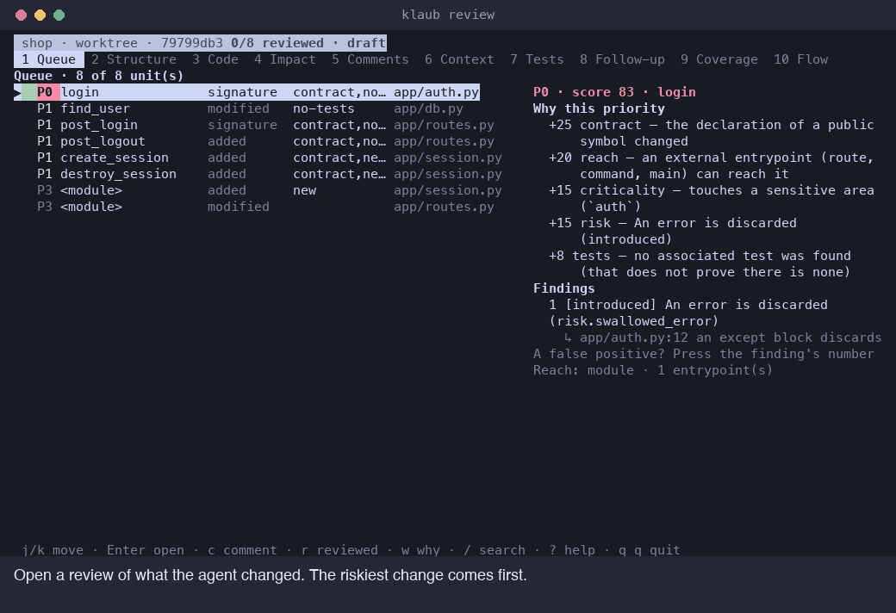

<p align="center">
  <picture>
    <source media="(prefers-color-scheme: dark)" srcset="https://raw.githubusercontent.com/myrk-kale/klaub/main/assets/logo-dark.png">
    
  </picture>
</p>

# Klaub: review AI-written code as a human

> **In short**
>
> - Klaub is a free, open-source terminal tool for the person who has to review what AI coding agents wrote.
> - It shows each change by function, ranks the changes by risk and says why, and traces who calls them.
> - It runs offline, uses no LLM, and never approves, rejects or fixes anything. You decide.

Klaub helps you review code written by AI coding agents such as Claude Code, Codex CLI and Aider, or any change in a Git repository. It reads the code the way the language does, so you review functions and classes instead of hunks. The queue puts the riskiest change first and shows the evidence for that order. Comments you write go back to the agent as one short instruction, and you press Enter.

<p align="center">
  <a href="https://github.com/myrk-kale/klaub/actions/workflows/ci.yml"></a>
  <a href="https://github.com/myrk-kale/klaub/releases/latest"></a>
  <a href="LICENSE"></a>
  
</p>

<p align="center">
  <a href="#quickstart-install-klaub-and-the-skills">Quickstart</a> |
  <a href="#install">Install</a> |
  <a href="#the-skills-help-your-agent-work-with-your-review">Skills</a> |
  <a href="#keyboard-shortcuts">Shortcuts</a> |
  <a href="#faq">FAQ</a> |
  <a href="#resources">Docs</a>
</p>

<p align="center">
  
</p>

## Quickstart: install Klaub and the skills

Three steps take you from nothing to a review. Each one is a single command.

### 1. Install Klaub

```sh
brew install myrk-kale/klaub/klaub
```

This works on macOS and on Linux. Without Homebrew, the [Install](#install) section has a script, Cargo and plain archives.

### 2. Install the skills for your agent

```sh
npx skills add myrk-kale/klaub
```

The [skills CLI](https://github.com/vercel-labs/skills) asks which skills and which agents to install them for, such as Claude Code and Codex. [The skills](#the-skills-help-your-agent-work-with-your-review) explains what each one does. Klaub works without them, so you can add them later.

### 3. Review what an agent changed

```sh
cd my-project
klaub review
```

Klaub opens the reviewer on what changed since `HEAD`. The riskiest change is first.

### Keep the agent beside the reviewer

To work with the agent and the reviewer side by side, start the agent through Klaub:

```sh
klaub wrap codex                 # or: klaub wrap -- claude --model <model>
```

Klaub runs the agent in a session of its own with a reviewer window next to it. Press `Ctrl+B` then `R` to open the reviewer, `Ctrl+B` then `A` to go back to the agent, and `Ctrl+B` then `D` to leave the session running in the background. `klaub session attach` brings it back.

### Your first review in six keys

1. Open the queue with `klaub review`. The riskiest change is first.
2. Press `w` to see why it has that priority.
3. Press `Enter` to read the whole function. Press `v` to flip between the old and the new version.
4. Press `i` for the contract and `4` for the callers and the routes that reach the change.
5. Press `c` to comment on a line, and `r` to mark a unit as reviewed.
6. Press `F` to finish. Klaub saves the comments and prepares one short instruction for the agent.

Press `?` at any time for the key list.

## Install

Klaub runs on macOS (Apple silicon and Intel) and on Linux (x86_64 and aarch64), and it needs Git on your `PATH`. Windows is not supported yet. Pick one of the ways below.

### Homebrew

On macOS and on Linux with [Homebrew](https://brew.sh):

```sh
brew install myrk-kale/klaub/klaub
```

Update with `brew upgrade klaub` and remove with `brew uninstall klaub`.

### Install script

Without Homebrew, the install script picks the release archive for your system, checks its SHA-256 and puts the binary in `~/.local/bin`:

```sh
curl -fsSL https://raw.githubusercontent.com/myrk-kale/klaub/main/scripts/install.sh | sh
```

Set `KLAUB_VERSION` to install a specific version and `KLAUB_INSTALL_DIR` to put the binary somewhere else. The variables go on the `sh` side of the pipe:

```sh
curl -fsSL https://raw.githubusercontent.com/myrk-kale/klaub/main/scripts/install.sh \
  | KLAUB_VERSION=0.3.1 KLAUB_INSTALL_DIR=/usr/local/bin sh
```

The script tells you when the install directory is not on your `PATH`.

### Cargo

With a Rust toolchain (1.90 or newer), from crates.io:

```sh
cargo install klaub --locked
```

Or straight from the repository:

```sh
cargo install --git https://github.com/myrk-kale/klaub klaub --locked
```

A build from source does not include the session runtime that `klaub wrap` uses. It looks for one on your `PATH`, and `klaub doctor` says which one it found. `klaub review` does not need it. The [development guide](docs/development.md) has the details.

### Release archive

Or download the archive for your system from the [releases page](https://github.com/myrk-kale/klaub/releases), check it against its `.sha256` file and unpack it:

| System | Archive |
| --- | --- |
| macOS, Apple silicon | `klaub-<version>-aarch64-apple-darwin.tar.gz` |
| macOS, Intel | `klaub-<version>-x86_64-apple-darwin.tar.gz` |
| Linux, x86_64 | `klaub-<version>-x86_64-unknown-linux-gnu.tar.gz` |
| Linux, aarch64 | `klaub-<version>-aarch64-unknown-linux-gnu.tar.gz` |

```sh
shasum -a 256 -c klaub-0.3.1-aarch64-apple-darwin.tar.gz.sha256     # sha256sum -c on Linux
tar -xzf klaub-0.3.1-aarch64-apple-darwin.tar.gz
install -m 0755 klaub-0.3.1-aarch64-apple-darwin/klaub ~/.local/bin/klaub
```

The archive holds the `klaub` binary, the license, the changelog and the notices of the third-party components that ship inside it. The Linux archives are built against glibc, so on a distribution that uses musl, such as Alpine, install with Cargo instead.

Each archive also has a build provenance attestation. With the [GitHub CLI](https://cli.github.com) you can check that it was built from this repository:

```sh
gh attestation verify klaub-0.3.1-aarch64-apple-darwin.tar.gz --repo myrk-kale/klaub
```

### Check the installation

```sh
klaub --version
klaub doctor
```

`klaub --version` prints the version. `klaub doctor` checks Git, your terminal, the grammars, the cache and the directories Klaub uses, and says what to fix.

### Install the skills

The skills need Node.js, because the [skills CLI](https://github.com/vercel-labs/skills) runs through `npx`.

```sh
npx skills add myrk-kale/klaub                       # choose the skills and the agents
npx skills add myrk-kale/klaub --list                # only list what the repository offers
npx skills add myrk-kale/klaub --skill klaub-feedback --agent claude-code codex
```

### Update and uninstall

Update with `brew upgrade klaub`, by running the install script again, or with `cargo install klaub --locked --force`. To uninstall, run `brew uninstall klaub`, delete `~/.local/bin/klaub`, or run `cargo uninstall klaub`. If you want, also remove the `.klaub/` folders in your repositories and Klaub's own state and cache directories, which `klaub doctor` prints. The skills are removed with the skills CLI (`npx skills --help` lists its commands).

## Agents write the code. A person still signs for it.

Klaub exists because reading agent output is now a large part of a developer's day, and the tools for it were built for something else. Its answer is a better lens for the person, not another model to judge the first one.

The numbers point at the gap. In [Sonar's 2026 State of Code survey](https://www.sonarsource.com/blog/state-of-code-developer-survey-report-the-current-reality-of-ai-coding/) of more than 1,100 developers, 96% said they do not fully trust AI-generated code, and only 48% said they always verify it before committing. 38% said reviewing AI code takes more effort than reviewing a colleague's. Developers reported that 42% of the code they commit is AI-generated or assisted. Sonar sells code verification and [The Register noted the possible bias](https://www.theregister.com/2026/01/09/devs_ai_code/), and the figures are self-reported, so read them as a signal and not as a measurement.

A common answer today is to ask a second model to review the first one's diff, as in [this write-up of Codex reviewing every Claude diff](https://zackproser.com/blog/codex-reviews-claudes-diffs). It can catch real problems. The same write-up treats the result as advisory, because a reviewing model can be wrong too. You still have to read the code to know which finding to believe.

Klaub takes the other route. It does not try to understand your code better than you do. It makes the code quicker to read and says where to look first, with the evidence on screen: a changed public contract, an entrypoint that reaches the function, a sensitive area, a missing test. The analysis is deterministic, so the same change gives the same queue, and every score can be taken apart. Nothing in Klaub acts for you. It does not approve, reject, submit or fix.

## A line diff is the wrong unit for agent output

Klaub shows functions, classes and methods, because that is the unit an agent changes and the unit you reason about. A new file is shown whole. A rewritten function appears in full with the old and the new version in the same place. A function that moved to another file is followed there instead of showing up as one deletion and one addition.

Each symbol is classified as added, removed, modified, moved, renamed, signature changed, rewritten or format only, with a confidence and the evidence for it. When Klaub is not sure two functions are the same one, it says so and keeps them apart instead of guessing.

Files in other languages are listed, shown whole and compared as text, and Klaub tells you that no semantic analysis was done for them.

## The queue tells you where to spend your attention

Every changed function, class and file is a unit in the queue, ordered P0 to P3. Press `w` on a unit to see the points that put it there: a changed contract, an entrypoint that reaches it, a sensitive area such as `auth`, a risk finding, a missing test. A sensitive word alone never produces a P0.

Findings are marked introduced, pre-existing, removed or unknown, so you can tell a new problem from one that was already there. The risks Klaub looks for are swallowed errors, queries built from dynamic text, secrets written in code, I/O inside loops, dynamic code execution, shell execution, unsafe blocks and disabled certificate checks. It also checks architecture rules you define, such as forbidden dependencies and new import cycles.

If a finding is a false positive, press `w`, then the finding's number, and Klaub silences that rule for the review. The priority is a heuristic that orders your reading. It is not a verdict on severity, and a P3 can still matter.

## Read a change the way it works

The current version fills the screen. Press `v` to swap it for the previous version in the same viewport, and `[` and `]` to jump between changed regions. Press `o` to open the unit inside its whole file. In a terminal that reports key releases, `[ui] hold_to_peek` lets you hold `B` to look at the old version and release it to come back.

Press `i` to see the contract: what a caller would notice. That means parameters and return type, decorators and annotations, the routes the symbol serves, the exceptions it raises or declares, its observable effects, and the public members of a type, each shown as added and removed lines. The same key works on migrations (SQL, Alembic, Django, Rails), dependency manifests and settings files, and it never shows secret values.

Press `4` to see the impact: the callers of the changed function, the functions it calls and the entrypoints that can reach it, with the path and the confidence of each hop. Every edge is labeled resolved, heuristic or unresolved, because a missing path is never evidence that nothing depends on the code. You can open any hop and pivot the view on it.

## Your comments reach the agent, and you press Enter

Comments are anchored to a symbol and a version, and they follow the symbol when lines move. If the commented code disappears, the comment is marked stale instead of landing on the wrong function. They are saved in the repository as versioned JSON.

When you finish, Klaub freezes the comments into a feedback file and offers to put one short instruction in the agent's input, to copy it, or to show the file. It shows the destination and the exact text first, and it sends one line as a bracketed paste, so it can never be read as a submission. You press Enter yourself.

In the next round the previous comments come back, and you decide for each one whether it was resolved, partly resolved, unresolved or a regression. The agent does not get to decide that.

For automation, `klaub review --wait` lets a script open the reviewer and wait for you. It exits with 0 when you finish the review and 3 when you close it as a draft, and with `--format json` it prints the review and nothing else. `klaub reviews export` writes a review as JSON, Markdown or SARIF 2.1.0, so comments can go to code scanning tools.

## The skills help your agent work with your review

Klaub ships two skills for your coding agent. They exist so that the agent cooperates with a review you run, not to hand the review to the agent. They install with the [skills CLI](https://github.com/vercel-labs/skills), as shown in the quickstart, and work with Claude Code, Codex and the other agents that CLI supports.

| Skill | What it makes your agent do | Where it ends |
| --- | --- | --- |
| `klaub-feedback` | Address the comments of a finished review one `comment_id` at a time, change the code each comment points at, and not merge, drop or invent comments. | You decide whether each comment was resolved. |
| `klaub-flow` | Write a flow diagram of the change under review as JSON, check it with `klaub flow validate`, and not edit application code. | Klaub validates it against the snapshot and you navigate it down to the real code. |

Without the skills, the agent still receives your comments as text. With them it knows the format, the order of work and the limits of its role.

The flow diagram is the visible one. Press `p` in the Flow view to ask your agent for it, then `L` to reload it. A diagram that is stale, malformed or points outside the repository is refused, and what the agent claims is treated as a hypothesis: where the index disagrees (a step whose symbol does not exist) the difference is shown.

## Tests, coverage and what you have not looked at

Klaub links changed symbols to the tests that probably exercise them and says how it knows (a reference, a name, a file). It reads JUnit and Coverage.py reports and tells you when they are older than the change. `X` runs your configured test command after showing it and asking, and it never runs anything on its own.

A coverage view tracks which units you have not reviewed yet, and `n` jumps to the next one. You can import a brief with `--brief FILE` and tick its acceptance criteria yourself. Opening a file, running tests or having no alerts never counts as reviewed.

## Supported languages

| Language | Extensions | What Klaub understands |
| --- | --- | --- |
| Python | `.py`, `.pyi` | Symbols, signatures, decorators, calls, imports, routes (FastAPI and Flask style), test functions, risk findings |
| JavaScript | `.js`, `.jsx`, `.mjs`, `.cjs` | Symbols, signatures, calls, imports and re-exports, Express style routes, risk findings |
| TypeScript | `.ts`, `.tsx`, `.mts`, `.cts` | The same as JavaScript, plus interfaces, types and enums |
| Rust | `.rs` | Functions, impls, traits, structs, enums, `use` paths, `Result` errors, `unsafe`, `#[test]` |
| Go | `.go` | Functions, methods, structs, interfaces, packages, `error` returns, routes, `main` |
| Java | `.java` | Classes, interfaces, enums, records, methods, annotations, `throws`, Spring and JAX-RS routes, JUnit tests |

Adding a language is a documented, step by step change: see [adding a language](docs/adding-a-language.md).

## Keyboard shortcuts

Every key below can be changed in `.klaub.toml` under `[keys]` ([configuration](docs/configuration.md)). Press `?` in the reader for the same list, `:` or `Ctrl+P` for the command palette, and `q` twice to close.

### Modes

| Key | Mode |
| --- | --- |
| `1` or `F2` | Queue |
| `2` or `F3` | Structure: modules, files and symbols |
| `3` or `F4` | Code |
| `4`, `g` or `F5` | Impact: callers, entrypoints, callees |
| `5` or `F6` | Comments |
| `6`, `b` or `F8` | Context: brief and acceptance criteria |
| `7`, `t` or `F7` | Tests |
| `8` or `F10` | Follow-up: decide on the previous round's comments |
| `9` | Coverage |
| `0`, `f` or `F9` | Flow |
| `Tab`, `Shift+Tab` | Next and previous mode |
| `Esc` | Go back |

### Moving and reading

| Key | Action |
| --- | --- |
| `j`, `k` or arrows | Move |
| `h`, `l` | Scroll sideways in code |
| `Enter` | Open the selected unit, symbol or step |
| `v` | Toggle old and new |
| `B` (hold) | Show the previous version while held, in supported terminals |
| `[`, `]` | Previous and next changed region |
| `o` | Open the unit in its whole file |
| `S` | Switch between the symbol and the whole file |
| `i` | Inspect the contract |
| `<`, `>` | Back and forward through the units you visited |
| `/` | Search |
| `+`, `-` | Show more or less in the structure tree |

### Reviewing

| Key | Action |
| --- | --- |
| `c` | Comment on the selection (`V` selects several lines) |
| `w` | Why this priority, and silence a false positive |
| `r` | Mark reviewed or unmark |
| `m`, `,` | Bookmark a unit, jump to the next bookmark |
| `n`, `P` | Next and previous unreviewed unit |
| `N` | Next unreviewed P0 or P1 unit |
| `e`, `d` | In Comments: edit or delete a draft |
| `y`, `p`, `u`, `X` | In Follow-up: resolved, partial, unresolved, regression |
| `F` | Finish the review |
| `R` | Take a new snapshot after the worktree changed |

### Filters and tools

| Key | Action |
| --- | --- |
| `H` | P0 and P1 only |
| `u` | Unreviewed only |
| `I` | Introduced by this change |
| `T` | Units without tests |
| `W` | New files |
| `s` | Minimum reach: local, module or global |
| `M` | Next module |
| `x` | Clear filters |
| `X` | Run the associated tests (asks first) |
| `U` | Reload test reports |
| `L` | Reload the flow diagram |
| `p` | In Impact: pivot on a symbol. In Flow: ask the agent for a diagram |

### Around the agent

These work after `klaub wrap`. Press the prefix (`Ctrl+B` by default), release it, then the key.

| Key | Action |
| --- | --- |
| `R` | Open the reviewer |
| `A` | Back to the agent |
| `I`, `C`, `T`, `B`, `L` | Open the reviewer on impact, comments, tests, brief or flow |
| `D` | Detach and leave the session running |
| `?` | Print these chords |

An optional mouse mode (`[ui] mouse = true`) adds wheel scrolling and clicks on tabs, rows and code lines.

## Command reference

| Command | What it does |
| --- | --- |
| `klaub review` | Open the reviewer. Options: `--base REV`, `--scope worktree\|staged\|unstaged\|branch`, `--brief FILE`, `--wait`, `--format json` |
| `klaub wrap <agent>` | Run an agent with a reviewer next to it. `--detach` starts it in the background |
| `klaub session list\|attach\|kill` | Manage wrapped sessions |
| `klaub reviews list\|show\|export` | List stored reviews, print one, export as JSON, Markdown or SARIF |
| `klaub feedback ID` | Print the feedback of a finished review |
| `klaub tests list\|run` | List test associations, or run the configured command after confirming |
| `klaub flow status\|context\|validate\|prompt` | Work with flow diagrams |
| `klaub doctor` | Check Git, the terminal, grammars, the cache, directories and SSH |
| `klaub crashes list\|show` | Read crash reports saved on this machine. Nothing is ever sent |
| `klaub completions SHELL` | Print a shell completion script |

## How it compares with other ways to review agent code

Klaub does not replace the other ways. It covers the part they leave to your eyes.

| Approach | What you read | Who judges | Where it falls short |
| --- | --- | --- | --- |
| The diff in the agent's own output | A line diff, in the order the agent made the edits | You, or the agent grading itself | No ranking, no callers, and a long session scrolls away |
| A pull request on a hosting site | A line diff, after you push | You and your teammates, with the bots you configured | The code leaves your machine before the first read, and the loop with the agent is slow |
| A second AI model as reviewer | The model's findings on the diff | A model, with you confirming each finding | Findings are probabilistic and can be wrong, so you still read the code |
| Klaub | Functions and classes, ranked, with callers and contracts | You, with the evidence on screen | It applies fixed rules, so it finds what the rules and the call graph can show, not every bug |

You can combine them. A second model's findings and Klaub's queue answer different questions, and tests answer a third.

## FAQ

### What is Klaub?

Klaub is a terminal application that helps a person review code changes by function and class, ranked by risk. It was built for reading what AI coding agents write, and it reviews any Git change.

### Who is Klaub for?

It is for the developer, tech lead or reviewer who has to read and sign off what an agent produced. It is not built for agents. The two skills let an agent cooperate with your review, and every decision stays with you.

### How do I review the code that Claude Code or Codex wrote?

Run `klaub wrap claude` or `klaub wrap codex` in your repository, let the agent work, then press `Ctrl+B` and `R`. You can also run `klaub review` in a second terminal at any time. When you finish, Klaub can prepare your comments in the agent's input so the agent can address them.

### Why does Klaub not use an LLM?

A reviewer you cannot explain is hard to trust, and a second model is one more thing to check. Klaub parses your code, matches symbols across versions, builds a call graph and applies fixed rules, so the same change gives the same queue and every score has a reason. The trade is honest: it cannot find a bug that needs understanding what the code is for.

### Does Klaub send my code anywhere?

No. Klaub makes no network requests, has no telemetry and needs no account. Comments and reviews are files under `.klaub/` in your repository, and crash reports stay on your machine.

### Will Klaub press Enter or submit anything in my agent?

Never. Putting text in the agent's input always shows you the destination and the exact text first, and it sends one line as a bracketed paste, so it cannot be read as a submission. You press Enter yourself.

### How do I install the Klaub skills?

Run `npx skills add myrk-kale/klaub`, choose the skills and the agents, and confirm. Add `--skill klaub-feedback --agent claude-code codex` to skip the questions. See [Install the skills](#install-the-skills).

### Which AI agents does it work with?

Codex CLI, Claude Code and Aider are the targets, and any interactive terminal program runs through `klaub wrap`. You can also use `klaub review` with no agent at all.

### Which programming languages does it support?

Python, JavaScript, TypeScript (including TSX), Rust, Go and Java get full semantic analysis. Other files are shown whole and compared as text. See [supported languages](#supported-languages).

### How is the priority of a change decided?

Klaub adds points for evidence: a changed public contract, an entrypoint that reaches the symbol, a sensitive area, a risk finding, growing complexity, missing tests. Press `w` to see every term. The weights live in `[priority]` and are described in [configuration](docs/configuration.md).

### How do I silence a false positive?

Open "Why this priority" with `w`, press the finding's number and confirm. The rule is silenced for that review and the queue is recomputed. "Bring back silenced rules" in the palette undoes it.

### Where are my comments stored?

In `.klaub/reviews/` at the root of the repository, as versioned JSON. Klaub does not edit `.gitignore` and does not commit anything. The first review of a repository tells you this once.

### Can I change the keys?

Yes. Every action, and every key that only works in one mode, can be moved to another single character under `[keys]`. The footer and the help show the keys you chose.

### How do I use Klaub in CI or with code scanning?

Run `klaub reviews export ID --format sarif`. Each comment becomes a result in a SARIF 2.1.0 log, with its priority in the properties.

### Does it work over SSH?

Yes, as a terminal program. The clipboard of your own machine is out of reach from a remote session, so use "Show file" or `klaub feedback` there. `klaub doctor` tells you when it detects SSH. See [using Klaub over SSH](docs/ssh.md).

### Does it run on Windows?

Not yet. Linux and macOS (Intel and Apple Silicon) are supported, and Windows is a possible future extension.

### How fast is it?

On a Django checkout with 7,000 files, opening a review of a 266 file change takes about 2 seconds the first time and 1 second with a warm cache. Projects of a few hundred files open in 0.3 to 1.1 seconds. A key press in a list takes well under 100 ms. [Benchmarks](docs/benchmarks.md) has the method and the limits of these numbers.

### How do I uninstall it?

Run `brew uninstall klaub`, delete `~/.local/bin/klaub`, or run `cargo uninstall klaub`, depending on how you installed it. [Update and uninstall](#update-and-uninstall) also covers the files Klaub leaves in your repositories and the skills.

## Resources

| | |
| --- | --- |
| [Configuration](docs/configuration.md) | Every `.klaub.toml` section, and how to move keys |
| [Architecture](docs/architecture.md) | How Klaub is built: layers, ports, data flow, the terminal layer |
| [Security model](docs/security.md) | Threats, controls and explicit limits |
| [Using Klaub over SSH](docs/ssh.md) | What works and what the clipboard cannot do |
| [Benchmarks](docs/benchmarks.md) | Latency on synthetic and real repositories |
| [Adding a language](docs/adding-a-language.md) | Every place a new grammar touches |
| [Development guide](docs/development.md) | Building from source, tooling and conventions |
| [Changelog](CHANGELOG.md) | What changed in each release |
| [Releasing](RELEASING.md) | How a release is cut |

## Contributing

Contributions are welcome. Start with [CONTRIBUTING.md](CONTRIBUTING.md) and read the [Code of Conduct](CODE_OF_CONDUCT.md). Report security issues as described in [SECURITY.md](SECURITY.md), and ask questions through [SUPPORT.md](SUPPORT.md).

## License

[MIT](LICENSE). The third-party components that ship inside releases keep their own licenses, listed in `THIRD-PARTY-NOTICES.md` in every release archive. Maintained by [myrk-kale](https://github.com/myrk-kale).
