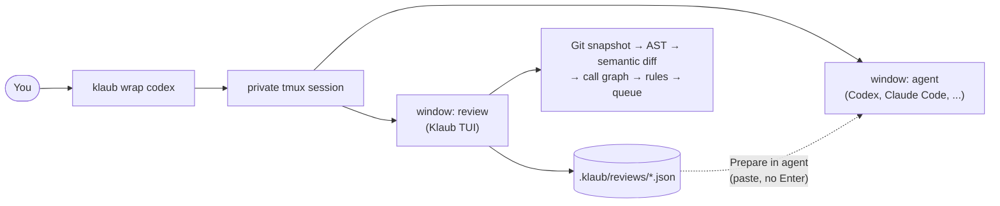

<h1 align="center">Klaub</h1>

<p align="center">
  <strong>A semantic code reviewer for humans that wraps any coding agent.</strong><br>
  Read the real code, find what deserves attention, and hand precise feedback back to the agent, without leaving the terminal or losing the session.
</p>

<p align="center">
  <a href="https://github.com/myrk-kale/klaub/actions/workflows/ci.yml"></a>
  <a href="LICENSE"></a>
  
  
  <a href="CONTRIBUTING.md"></a>
</p>

<p align="center">
  <a href="README.pt-BR.md">Português</a> ·
  <a href="docs/architecture.md">Architecture</a> ·
  <a href="docs/specification.pt-BR.md">Specification</a> ·
  <a href="CONTRIBUTING.md">Contributing</a>
</p>

---

> **Status: under active development.** The foundation and the roadmap below are in the repository; features are marked as they land. See the [changelog](CHANGELOG.md).

## Why Klaub

Reviewing what a coding agent wrote is slow with a line diff: new files have no hunks, rewrites misalign, side-by-side views waste width, and nothing tells you *what contract changed* or *who calls it*. Klaub is built for that moment.

- **Semantic, not line-based.** Navigate by module, file, class, function and block. A new file is shown whole; a rewritten function is shown in full, `before` and `after` in the same viewport.
- **A review queue, not an alphabetical list.** P0–P3 priorities come from itemised, explainable evidence, and every finding says whether it was *introduced*, *preexisting*, *removed* or *unknown*.
- **Impact you can follow.** A reverse call graph from the changed symbol up to the entrypoints that can reach it, with the confidence of every edge (`resolved`, `heuristic`, `unresolved`).
- **Same terminal, same session.** `klaub wrap codex` (or `claude`, or any interactive program) runs the agent in a private tmux session; one key chord flips between the agent and the reviewer.
- **Feedback that lands where it belongs.** Comments are saved as a versioned JSON file in the repository. Klaub can *prepare* a short instruction in the agent's input. It never presses `Enter` for you.
- **Offline, deterministic, no LLM.** No account, no API key, no telemetry, no network.
- **Human in charge.** Klaub never approves, rejects, certifies or fixes code. It helps you answer: *what changed, why, what can be affected, what evidence exists, and what have I not inspected yet?*

## How it works



## Quick start

> Installation instructions will be added with the first release. Until then, build from source:

```shell
git clone https://github.com/myrk-kale/klaub && cd klaub
cargo install --path crates/klaub-cli --locked
```

```shell
cd my-project
klaub wrap codex                 # or: klaub wrap -- claude --model <model>
# Ctrl+B, R   open the reviewer     Ctrl+B, A   back to the agent
# c           comment               r           mark reviewed
# F           finish review         Prepare in agent → press Enter yourself
```

Outside a wrapped session, `klaub review` opens the same reviewer for the current worktree and lets you copy or export the feedback.

## Documentation

| | |
| --- | --- |
| [Architecture](docs/architecture.md) | Hexagonal layout, crates, ports, data flow |
| [Architecture decisions](docs/adr/) | Why things are the way they are |
| [Security model](docs/security.md) | Threats, controls, explicit limits |
| [Development guide](docs/development.md) | Tooling, conventions, adding adapters |
| [Specification](docs/specification.pt-BR.md) | Product behaviour and acceptance criteria (Portuguese) |

## Roadmap

| Phase | Scope | Status |
| --- | --- | --- |
| Foundation | Workspace, lints, CI, community files, ADRs | ✅ |
| 0 | Embedded tmux, `wrap`, pane identity, safe bracketed paste, minimal TUI | ⏳ |
| 1 | Git snapshots, Python and JS/TS, semantic matching, queue, reverse call graph, comments, brief, tests evidence, incremental risk | ⏳ |
| 2 | Architecture rules, contract inspector, follow-up, review coverage, `Flow` and the `klaub-flow` skill | ⏳ |
| 3 | More languages, general feedback skill, export formats, harness adapter seam | ⏳ |

## Contributing

Contributions are welcome. Start with [CONTRIBUTING.md](CONTRIBUTING.md); please read the [Code of Conduct](CODE_OF_CONDUCT.md). Security issues go through [SECURITY.md](SECURITY.md).

## Licence

[MIT](LICENSE). The embedded tmux, libevent and ncurses keep their own licences, shipped with every release in `THIRD-PARTY-NOTICES.md`.
