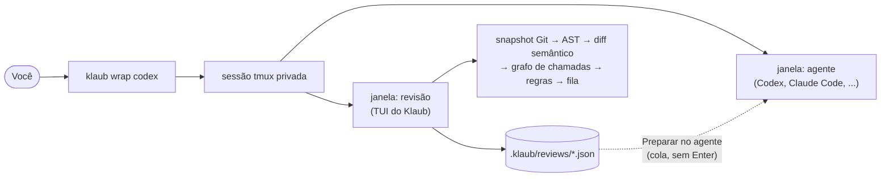

<h1 align="center">Klaub</h1>

<p align="center">
  <strong>Um revisor semântico de código para humanos que envolve qualquer agente de programação.</strong><br>
  Leia o código real, descubra o que merece atenção e devolva instruções precisas ao agente sem sair do terminal nem perder a sessão.
</p>

<p align="center">
  <a href="README.md">English</a> ·
  <a href="docs/architecture.md">Arquitetura</a> ·
  <a href="docs/specification.pt-BR.md">Especificação</a> ·
  <a href="CONTRIBUTING.md">Contribuindo</a>
</p>

---

> **Status: em desenvolvimento ativo.** As fases 0 e 1 estão implementadas. O leitor semântico tem fila, estrutura, código com antes e depois, impacto, comentários, contexto, testes, follow-up, cobertura e flow. As fases 2 e 3 não estão prontas. A checagem manual contra uma sessão real do Codex ou do Claude Code ainda está pendente. O primeiro release com tag é o v0.1.0. Veja o [changelog](CHANGELOG.md).

## Por que o Klaub

Revisar o que um agente escreveu com um diff de linhas é lento: arquivos novos não têm hunks, reescritas desalinham, a visão lado a lado desperdiça largura e nada diz *qual contrato mudou* ou *quem chama isso*. O Klaub existe para esse momento.

- **Semântico, não por linhas.** Navegue por módulo, arquivo, classe, função e bloco. Arquivo novo aparece inteiro; função reescrita aparece completa, `antes` e `depois` no mesmo viewport.
- **Fila de revisão, não lista alfabética.** Prioridades P0–P3 vêm de evidências explicáveis e cada achado diz se foi *introduzido*, *preexistente*, *removido* ou *desconhecido*.
- **Impacto navegável.** Grafo reverso de chamadas do símbolo alterado até os entrypoints, com a confiança de cada aresta (`resolved`, `heuristic`, `unresolved`).
- **Mesmo terminal, mesma sessão.** `klaub wrap codex` (ou `claude`, ou qualquer programa interativo) roda o agente numa sessão tmux privada; um atalho alterna entre agente e revisor.
- **Feedback no lugar certo.** Comentários são salvos num JSON versionado no repositório. O Klaub pode *preparar* uma instrução curta no input do agente. Ele nunca aperta `Enter` por você.
- **Offline, determinístico, sem LLM.** Sem conta, sem chave de API, sem telemetria, sem rede.
- **O humano decide.** O Klaub nunca aprova, reprova, certifica nem corrige código. Ele ajuda a responder: *o que mudou, por quê, o que pode ser afetado, que evidência existe e o que ainda não inspecionei?*

## Como funciona



## Instalação

O primeiro release com tag é o v0.1.0. Há binários prontos para Linux x86_64 e macOS Apple Silicon. macOS Intel não entra na matriz de release. Num Mac Intel, compile do código-fonte.

### Homebrew

Funciona no macOS e no Linux onde o Homebrew está instalado. A fórmula está no tap `myrk-kale/homebrew-klaub`. Não há bottle pré-compilado para macOS Intel. Essas máquinas compilam do código-fonte.

```shell
brew tap myrk-kale/klaub
brew install klaub
```

### curl

macOS e Linux. O script confere o SHA-256 do arquivo antes de instalar qualquer coisa. Suporta só Linux x86_64 e macOS Apple Silicon.

`KLAUB_VERSION` escolhe a versão (`0.1.0`). `KLAUB_INSTALL_DIR` escolhe o diretório (padrão `~/.local/bin`).

```shell
curl -fsSL https://raw.githubusercontent.com/myrk-kale/klaub/main/scripts/install.sh | sh
```

### Do código-fonte

Precisa de Rust 1.90+, git e um tmux 3.2 ou mais novo no `PATH` até o release embarcar um. Aponte `KLAUB_TMUX_PATH` para esse tmux.

```shell
git clone https://github.com/myrk-kale/klaub && cd klaub
cargo install --path crates/klaub-cli --locked
export KLAUB_TMUX_PATH="$(command -v tmux)"
klaub doctor
```

## Início rápido

```shell
cd meu-projeto
klaub wrap codex                 # ou: klaub wrap -- claude --model <modelo>
# Ctrl+B, R   abre o revisor        Ctrl+B, A   volta ao agente     Ctrl+B, d   desanexa
# Ctrl+B, I   impacto   C   comentários   T   testes   B   brief   L   flow
klaub session list               # depois: klaub session attach
```

O prefixo é `Ctrl+B`, a menos que você defina `--prefix` ou `KLAUB_TMUX_PREFIX`. `Prefix+?` mostra os atalhos. `Prefix+R` e `Prefix+A` trocam de janela. `Prefix+I`, `C`, `T`, `B` e `L` abrem o revisor e mandam `F5` a `F9` para ele (impacto, comentários, testes, brief, flow).

`klaub review` abre o leitor semântico, inclusive de dentro do wrap. A revisão do worktree é o padrão.

Outros comandos:

- `klaub review --base REV --scope worktree|staged|unstaged|branch --brief ARQUIVO` compara contra uma revisão, um escopo ou um arquivo de brief local.
- `klaub reviews list` lista as revisões gravadas. `show ID` imprime uma. `export ID` grava JSON ou Markdown.
- `klaub feedback ID` imprime o feedback de uma revisão finalizada.
- `klaub tests list --review ID` lista as associações de teste. `run --review ID` mostra o comando e pergunta antes de rodar.
- `klaub flow status` diz se o snapshot tem um diagrama de flow. `context` imprime o contexto do snapshot em JSON. `validate ARQUIVO` confere um documento de flow. `prompt` imprime a instrução que pede um diagrama ao agente, e não envia nada.
- `klaub skills install flow|feedback --harness codex|claude` copia uma skill empacotada para a configuração desse agente.

## Documentação

| | |
| --- | --- |
| [Arquitetura](docs/architecture.md) | Layout hexagonal, crates, portas, fluxo de dados |
| [Decisões de arquitetura](docs/adr/) | Por que as coisas são como são |
| [Modelo de segurança](docs/security.md) | Ameaças, controles, limites explícitos |
| [Guia de desenvolvimento](docs/development.md) | Ferramentas, convenções, como adicionar adapters |
| [Configuração](docs/configuration.md) | Cada seção do `.klaub.toml` e como mover as teclas do leitor (em inglês) |
| [Especificação](docs/specification.pt-BR.md) | Comportamento do produto e critérios de aceitação |
| [Aceitação](docs/acceptance.md) | Quais checagens de aceitação o CI roda e quais precisam de uma pessoa com um agente real (em inglês) |
| [Benchmarks](docs/benchmarks.md) | Latência frente às metas da especificação e o que os números não dizem (em inglês) |
| [Klaub por SSH](docs/ssh.md) | O que funciona e o que a área de transferência não alcança (em inglês) |
| [Adicionar uma linguagem](docs/adding-a-language.md) | Todos os pontos que uma nova gramática tree-sitter toca (em inglês) |

## Roadmap

| Fase | Escopo | Status |
| --- | --- | --- |
| Fundação | Workspace, lints, CI, arquivos de comunidade, ADRs | ✅ |
| 0 | tmux embarcado, `wrap`, identidade de pane, bracketed paste seguro, TUI mínima ([gate](docs/phase-0-gate.md)) | ✅ implementada; checagem manual com harnesses reais pendente |
| 1 | Snapshots Git, Python e JS/TS, matching semântico, fila, grafo reverso, comentários, brief, evidência de testes, risco incremental | ✅ implementada |
| 2 | Regras de arquitetura, inspetor de contratos, follow-up, cobertura da revisão, `Flow` e a skill `klaub-flow` | ✅ implementada, incluindo contratos de migrações, manifestos e configurações, silenciar um falso positivo, árvore de fluxo dobrável com breadcrumbs, teclas configuráveis e `review --wait` |
| 3 | Mais linguagens, skill geral de feedback, formatos de exportação, ponto de extensão para adapters de harness | ✅ Rust e Go além da lista da especificação, a skill `klaub-feedback`, exportações JSON, Markdown e SARIF, e [um guia para adicionar uma linguagem](docs/adding-a-language.md). O ponto de extensão `HarnessAdapter` continua documentado e Windows/WSL continua uma [investigação](docs/windows.md): a especificação deixa os dois fora destas versões. |

Pronto nos testes não é o mesmo que pronto na sua máquina. As checagens que a especificação faz contra sessões reais do Codex CLI e do Claude Code, terminais reais e SSH estão em [docs/acceptance.md](docs/acceptance.md) como manuais, e nenhuma foi executada por um teste automatizado.

## Contribuindo

Contribuições são bem-vindas. Comece por [CONTRIBUTING.md](CONTRIBUTING.md) e leia o [Código de Conduta](CODE_OF_CONDUCT.md). Problemas de segurança seguem [SECURITY.md](SECURITY.md).

## Licença

[MIT](LICENSE). O tmux, libevent e ncurses embarcados mantêm suas próprias licenças, distribuídas em cada release em `THIRD-PARTY-NOTICES.md`.
