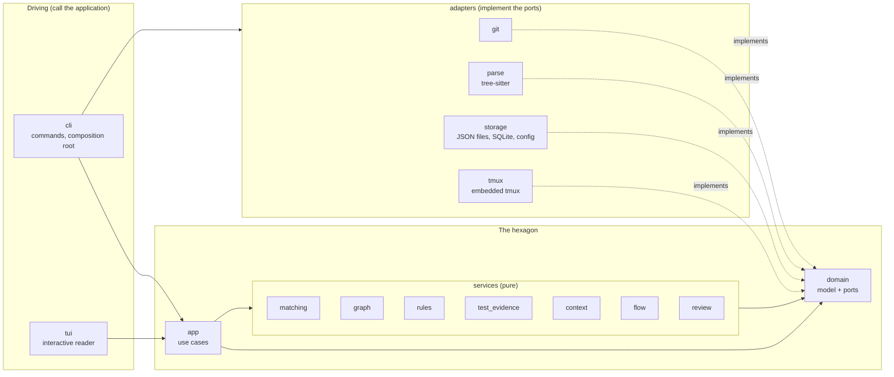
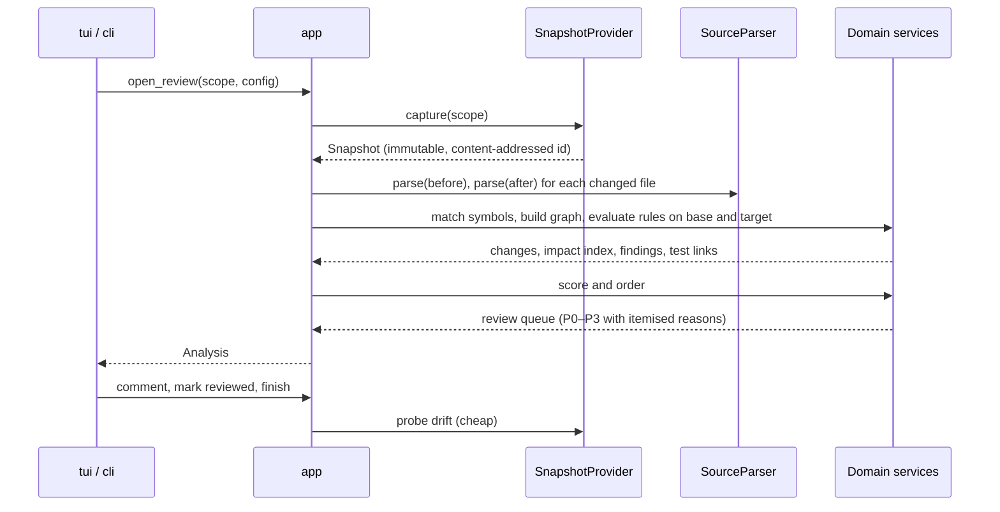

# Architecture

## What it is built with

Klaub is written in Rust (stable, minimum version 1.90). The pieces that matter for how it behaves:

| Concern | Technology |
| --- | --- |
| Terminal interface | [Ratatui](https://ratatui.rs) with crossterm, in an Elm-style loop: state, `handle_key`, `draw` |
| Parsing | tree-sitter grammars for Python, JavaScript, TypeScript and TSX, Rust, Go and Java |
| Agent session | A private tmux server per session, with a verified tmux binary embedded in release builds. It keeps the agent alive, addresses its pane by id and pastes with bracketed paste |
| Git | The `git` executable, with argument arrays, NUL-separated output and a scrubbed environment |
| Storage | Atomic JSON files for reviews, SQLite for the parse cache |
| Command line | clap |

Klaub follows the **hexagonal (ports and adapters) architecture**. The business of the product, which is understanding what changed, ranking it and recording a human's feedback, sits in the middle and knows nothing about Git, tree-sitter, SQLite, tmux or terminals. Everything that touches the outside world is an adapter that plugs into a port (a Rust trait) owned by the core.

## One crate, layers by convention

Klaub is a single crate, `klaub`, with a library and a binary. The layers are modules under `src/`, and the direction of the dependencies between them is kept by a test instead of by the compiler: `tests/architecture.rs` reads the sources and fails CI when a layer names something it must not. A split into several crates would add a publication order and a manifest per piece, and nothing here is reused as a library, so the boundary is cheap to keep in the open.

Dependencies point inward. An adapter names `domain` for the port it implements and nothing else; adapters never name each other. Only `cli` sees every adapter, because wiring them is its job. A service names `domain`, and `rules` also names `graph`.

## Modules

| Module | Layer | Responsibility |
| --- | --- | --- |
| `domain` | Domain | Domain model (snapshots, symbols, changes, findings, reviews), configuration schema, the **ports** (`domain::ports`), text sanitisation. No I/O. |
| `services::matching` | Domain service | Temporal symbol matching (`before ↔ after`) with confidence and evidence; move, rename and rewrite detection. |
| `services::graph` | Domain service | Call and dependency graph, entrypoint detection, reverse traversal and impact scope. |
| `services::rules` | Domain service | Evidence-based rules evaluated on base and target, the `introduced / preexisting / removed / unknown` delta, scoring and the P0–P3 queue. |
| `services::test_evidence` | Domain service | Test association heuristics, JUnit and Coverage.py report import, staleness. |
| `services::context` | Domain service | Review brief, acceptance criteria, human review coverage. |
| `services::flow` | Domain service | Flow document schema, validation, `current / missing / invalid / stale` status, prompt text. |
| `services::review` | Domain service | Comments, anchors and relocation, state machine, follow-up decisions, feedback payload. |
| `app` | Application | Use cases that orchestrate ports and services into an analysis and a review session. |
| `adapters::git` | Driven adapter | `SnapshotProvider` and workspace reading through the Git CLI. |
| `adapters::parse` | Driven adapter | `SourceParser` with tree-sitter grammars. |
| `adapters::storage` | Driven adapter | Review repository (atomic JSON), analysis cache (SQLite), flow repository, configuration loading. |
| `adapters::tmux` | Driven adapter | Embedded and verified tmux runtime, one private server per session, pane identity, single-line bracketed paste. |
| `adapters` (`process`, `system`) | Driven adapter | The user's test command, the clipboard, the clock and random identifiers. |
| `tui` | Driving adapter | Ratatui application: Elm-style model, pure `update`, rendering. |
| `cli` | Driving adapter + composition root | `clap` commands, wiring of adapters to ports, process-level concerns (logging, exit codes). |

## Ports

Ports live in `domain::ports`. Each has an in-memory fake in tests.

| Port | Purpose | Production adapter |
| --- | --- | --- |
| `SnapshotProvider` | Capture an immutable snapshot, read project files, probe for drift | `adapters::git` |
| `SourceParser` | Symbols, calls, imports, entrypoint hints, highlight spans | `adapters::parse` |
| `ReviewRepository` | Persist and load reviews and feedback | `adapters::storage` |
| `FlowRepository` | Read flow documents by snapshot id | `adapters::storage` |
| `AnalysisCache` | Derived-data cache keyed by content hash and parser version | `adapters::storage` |
| `ConfigSource` | Load project and user configuration | `adapters::storage` |
| `AgentChannel` | Describe the agent pane and paste text into it | `adapters::tmux` |
| `Clipboard` | Copy text for the user | `adapters::process` |
| `TestRunner` | Run the user-configured test command after confirmation | `adapters::process` |
| `Clock`, `IdGenerator` | Time and identifiers, replaceable for deterministic tests | `adapters::system` |

### Extension point for harness adapters

`domain::harness` holds the `HarnessAdapter` trait, the `GenericHarness` fallback and a `HarnessRegistry` that picks an adapter by the name of the program in the agent pane. An adapter can say whether a program looks ready or busy and whether text was submitted, and the reader shows what it says in the paste confirmation. It is deliberately **not** relied on: with only the generic adapter, which knows nothing, the flow is the universal "bracketed paste, no `Enter`" contract. No Codex or Claude Code adapter ships; the specification waits for a readiness contract and an acceptance per harness.

## How a review is produced

## Concurrency model

The snapshot is immutable for the lifetime of a reading session. A background probe compares a cheap signature of the worktree with the one captured; a mismatch shows a banner, and the reviewer decides when to run *Update review*, which creates a new snapshot and relocates anchors. Nothing is refreshed silently.

## Failure model

Errors are values (`domain::Error`). A parser that fails on a file degrades that file to textual review with an explicit notice. A failed rule never aborts an analysis. Comments are written before anything else happens, so a crash loses nothing that was confirmed on disk.

## Testing strategy

| Level | Where | What it proves |
| --- | --- | --- |
| Unit | `#[cfg(test)]` modules next to the code | Pure logic with plain values; property tests for matching and anchors |
| Fixtures | `fixtures/`, `tests/` | Real throwaway Git repositories and source files with known expected results |
| Integration | `tests/wrapper.rs`, `tests/cli.rs` | A real tmux server on a private socket, bracketed paste, session survival, the binary end to end |
| UI | `src/tui` and `tests/reader.rs` | Pure `update` tests and `TestBackend` render snapshots at several terminal sizes |
| Architecture | `tests/architecture.rs` | The direction of the dependencies between layers, adapters named only by `cli`, and no I/O in `domain`, `services` and `app` |
