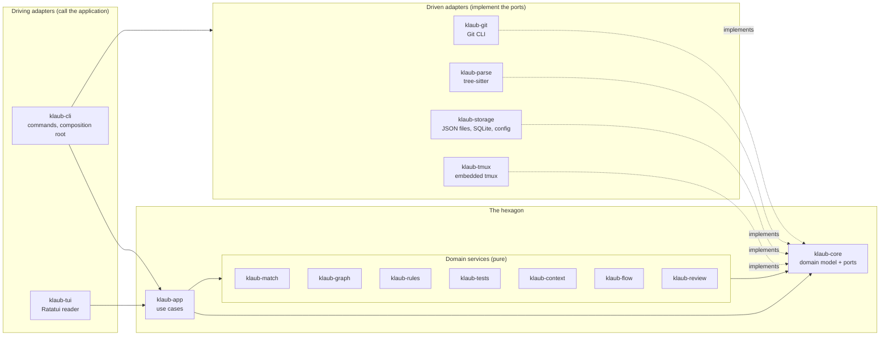
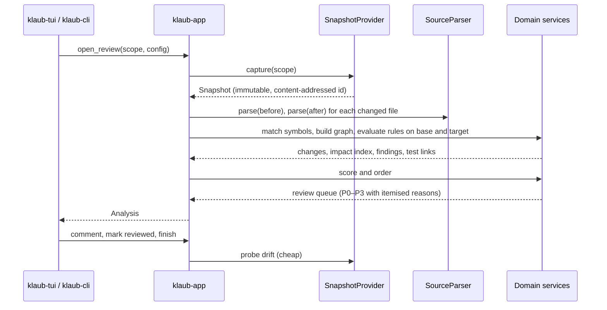

# Architecture

Klaub follows the **hexagonal (ports and adapters) architecture**. The business of the product, which is understanding what changed, ranking it and recording a human's feedback, sits in the middle and knows nothing about Git, tree-sitter, SQLite, tmux or terminals. Everything that touches the outside world is an adapter that plugs into a port (a Rust trait) owned by the core.

The decision and its rationale are recorded in [ADR 0002](adr/0002-hexagonal-architecture.md).

## Layers

Dependencies point inward. Adapters depend on `klaub-core` for the port they implement and on nothing else in the workspace; they never depend on each other. `klaub-cli` is the only crate that sees every adapter, because wiring them is its job.

## Crates

| Crate | Layer | Responsibility |
| --- | --- | --- |
| `klaub-core` | Domain | Domain model (snapshots, symbols, changes, findings, reviews), configuration schema, the **ports**, text sanitisation. No I/O. |
| `klaub-match` | Domain service | Temporal symbol matching (`before ↔ after`) with confidence and evidence; move, rename and rewrite detection. |
| `klaub-graph` | Domain service | Call and dependency graph, entrypoint detection, reverse traversal and impact scope. |
| `klaub-rules` | Domain service | Evidence-based rules evaluated on base and target, the `introduced / preexisting / removed / unknown` delta, scoring and the P0–P3 queue. |
| `klaub-tests` | Domain service | Test association heuristics, JUnit and Coverage.py report import, staleness. |
| `klaub-context` | Domain service | Review brief, acceptance criteria, human review coverage. |
| `klaub-flow` | Domain service | Flow document schema, validation, `current / missing / invalid / stale` status, prompt text. |
| `klaub-review` | Domain service | Comments, anchors and relocation, state machine, follow-up decisions, feedback payload. |
| `klaub-app` | Application | Use cases that orchestrate ports and domain services into an analysis and a review session. |
| `klaub-git` | Driven adapter | `SnapshotProvider` and workspace reading through the Git CLI. |
| `klaub-parse` | Driven adapter | `SourceParser` with tree-sitter grammars. |
| `klaub-storage` | Driven adapter | Review repository (atomic JSON), analysis cache (SQLite), flow repository, configuration loading. |
| `klaub-tmux` | Driven adapter | Embedded tmux runtime, private server, sessions and windows, pane identity, safe paste. |
| `klaub-tui` | Driving adapter | Ratatui application: Elm-style model, pure `update`, rendering. |
| `klaub-cli` | Driving adapter + composition root | `clap` commands, wiring of adapters to ports, process-level concerns (logging, exit codes). |

## Ports

Ports live in `klaub-core::ports`. Each has an in-memory fake in tests.

| Port | Purpose | Production adapter |
| --- | --- | --- |
| `SnapshotProvider` | Capture an immutable snapshot, read project files, probe for drift | `klaub-git` |
| `SourceParser` | Symbols, calls, imports, entrypoint hints, highlight spans | `klaub-parse` |
| `ReviewRepository` | Persist and load reviews and feedback | `klaub-storage` |
| `FlowRepository` | Read flow documents by snapshot id | `klaub-storage` |
| `AnalysisCache` | Derived-data cache keyed by content hash and parser version | `klaub-storage` |
| `ConfigSource` | Load project and user configuration | `klaub-storage` |
| `AgentChannel` | Describe the agent pane and paste text into it | `klaub-tmux` |
| `Clipboard` | Copy text for the user | `klaub-cli` |
| `TestRunner` | Run the user-configured test command after confirmation | `klaub-cli` |
| `Clock`, `IdGenerator` | Time and identifiers, replaceable for deterministic tests | `klaub-cli` |

### Extension point for harness adapters

Phase 3 of the roadmap reserves a `HarnessAdapter` seam: harness-specific readiness detection and confirmed submission. It is deliberately **not** used by phases 0–2, which only rely on the universal "bracketed paste, no `Enter`" contract ([ADR 0005](adr/0005-human-confirmed-paste-never-enter.md)).

## How a review is produced

## Concurrency model

The snapshot is immutable for the lifetime of a reading session. A background probe compares a cheap signature of the worktree with the one captured; a mismatch shows a banner, and the reviewer decides when to run *Update review*, which creates a new snapshot and relocates anchors. Nothing is refreshed silently.

## Failure model

Errors are values (`klaub_core::Error`). A parser that fails on a file degrades that file to textual review with an explicit notice. A failed rule never aborts an analysis. Comments are written before anything else happens, so a crash loses nothing that was confirmed on disk.

## Testing strategy

| Level | Where | What it proves |
| --- | --- | --- |
| Unit | each crate's `src` | Pure logic with plain values; property tests for matching and anchors |
| Fixtures | `fixtures/`, crate `tests/` | Real throwaway Git repositories and source files with known expected results |
| Integration | `klaub-tmux/tests`, `klaub-cli/tests` | A real tmux server on a private socket, bracketed paste, session survival |
| UI | `klaub-tui` | Pure `update` tests and `TestBackend` render snapshots at several terminal sizes |
| Architecture | `klaub-cli/tests/architecture.rs` | Dependency direction and I/O-free core are enforced |
